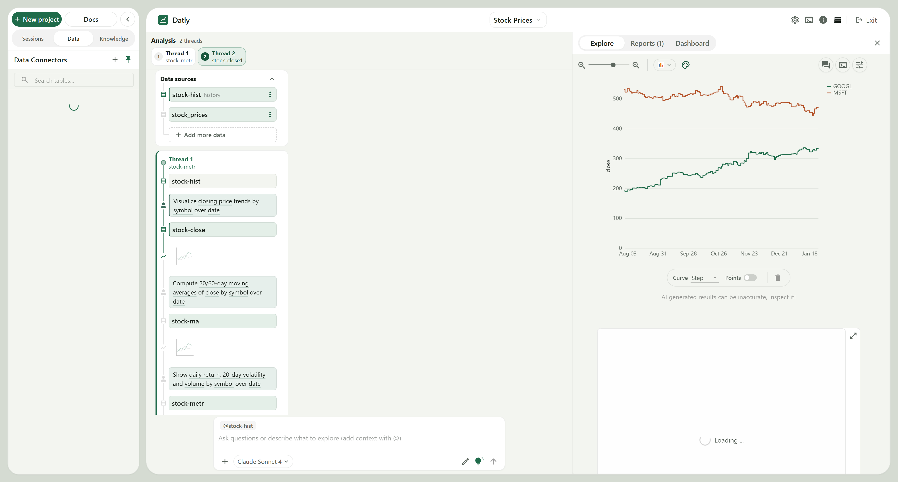
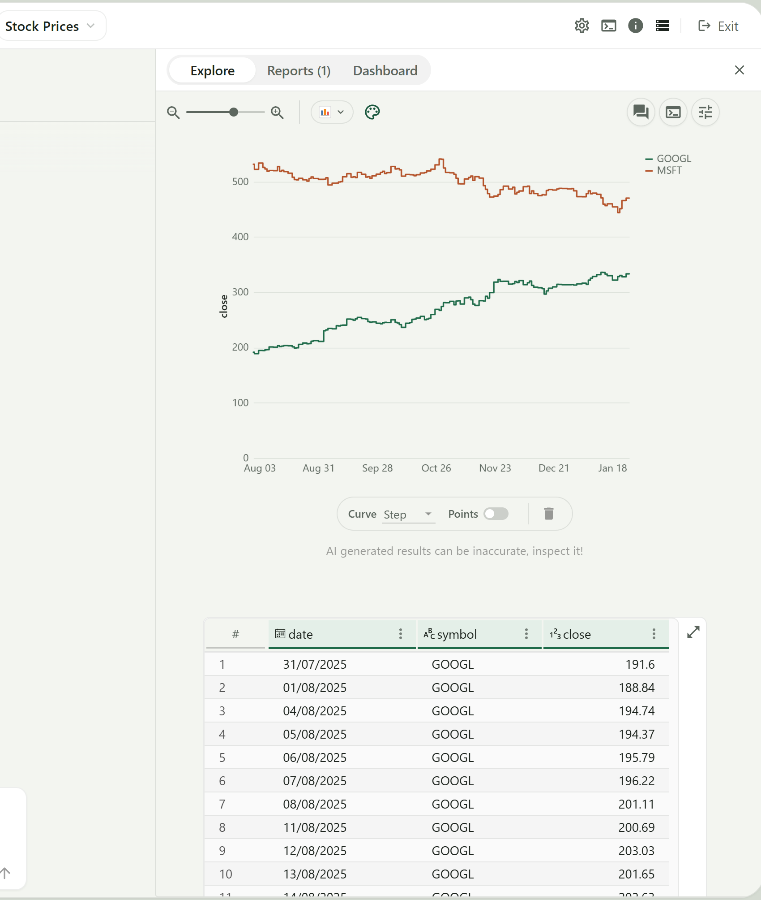
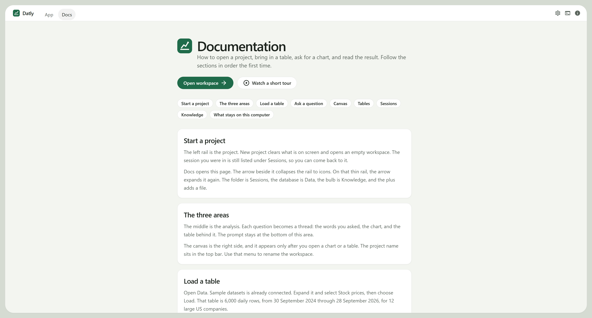

# Datly

A table already holds the answer, and it is still hard to see. The numbers sit in a grid. The question is in someone's head. The chart, when it exists, is in another program, and nobody can point at the row the line came from.

Datly is the workspace for that job. The table stays here. The question is written in ordinary language. The chart opens on the same screen as the rows it was drawn from, and the question is kept next to both of them.

This page is the app. The pictures are the running window. The text under each one says what that part is doing.

## What we are trying to solve

The usual path splits the work into three tools.

A spreadsheet or a database holds the rows. A charting tool wants the columns dragged onto shelves before the question is clear. A chat window will draw a picture and then forget which rows it used. The person checking the result has to trust the picture, or go back and find the cells by hand.

That split is the problem.

* The question is lost. A file named `chart-final-v3` does not say what was asked.
* The chart is separated from the rows. A line can be wrong and still look smooth.
* The path is gone. The second question ("now just Apple, and add volume") has no record of the first.
* The file has to leave the machine before any of this can start, if the tool is a hosted notebook.

Datly keeps those pieces in one project, on this computer.

You load the table once. You ask in a sentence. The answer comes back as a thread: the words, the chart, and the table behind the chart. The next question is another thread, or a follow-up on the same one, and both stay in the project. When the line looks surprising, the rows are on the same screen. A language model helps build the chart. It receives a sample with the prompt, not a copy of the file stored on someone else's server.

The picture below is that job, already in progress. The project is named Stock Prices. The table is loaded. Two questions have been asked. The canvas is showing the second answer, and the grid under the line is the data the line was drawn from.



## The app, from the left of that picture

The left card is how a project is opened and how a table gets in.

**+ New project** starts an empty workspace. The session on screen is cleared. It is not deleted. It remains in the session list, so the stock work in this picture can be opened again later. **Docs** is the guide inside the app, the same account of the product as this page. The arrow beside Docs folds the card down to a strip of icons, so the chart can use the width. The arrow on that strip opens the card again.

**Sessions**, **Data**, and **Knowledge** are the three jobs of the card. Sessions is the list of projects saved on this computer. Data is where tables come from. Knowledge is the standing instruction for the agent, the rules it should keep on later questions. In the picture, Data is selected.

Under Data Connectors, search filters the list. The plus adds a database. The pin holds the card open instead of letting it close when you click back into the analysis. **Sample datasets** is already connected, and it is marked Active. **Stock prices** has a tick, so those rows are in the project. The circle beside the tick loads the table again.

That sample is the stand-in for a file of your own. It is 6,000 daily prices, 30 September 2024 through 28 September 2026, for twelve large US companies across technology, consumer, financials, health, energy, and industrials. The columns are date, symbol, company, sector, open, high, low, close, and volume. Prices are adjusted for splits, so a line does not jump when the shares split. The source is Yahoo Finance. A spreadsheet or an export uses the plus on the collapsed rail, or **Add more data** inside a thread. A database uses the plus beside Data Connectors.

Nothing on this card draws the chart. It only answers the first half of the problem: the rows are here, named, and still on this machine.

## The middle: the question is not thrown away

The middle of the picture is the analysis. **Stock Prices**, in the top bar, is this project. The menu renames it. The Datly mark sits at the left of that bar.

**Analysis** says two threads. A thread is one question and everything that came back from it. Thread 1 is `stock-metr`. Thread 2, drawn in green, is `stock-close1`. The canvas on the right is showing thread 2, which is why that pill is filled.

Thread 1 is the column of cards. One card is a small chart of several symbols, named `stock-close`. Under it is the question in the words that were typed: 20-day and 60-day moving averages of close, by symbol. The next card, `stock-ma`, is the chart of that question. The question after that asks for daily return, 20-day volatility, and volume. `stock-metr` is the noisy chart at the bottom of the column. The path is the column. You can read what was asked without opening another file.

The white box at the bottom is where the next question is typed. It is pointed at `@stock-hist`, the history table, so the question is about those rows and not about a table that happens to be focused by accident. The line in the box says “Ask questions or describe what to explore.” The model chosen for this session is Claude Sonnet 4, shown on the left of the box. The arrow sends. A useful question names the columns. The lines on the right are what came back from a question of that kind: closing price by date for Alphabet and Microsoft.

The prompt sits on the sage field of the window. There is no fade behind it.

## The right: the chart has to face the rows

The canvas is the check. **Explore** is selected. **Reports (1)** is a written page already saved from this project, the chart with the sentences around it. **Dashboard** is where more than one chart is pinned so they stay in view together. The cross closes the canvas. The threads are not deleted. They spread into the width the canvas was using, and the same chart can be opened again from its card.

The plot is closing price. Green is GOOGL. It leaves the left of the axis near 190 in early August and is near 330 by the middle of January. Orange is MSFT. It stays between about 450 and 530, highest in late October, lower in January. The dates run from 3 August to 18 January, weekdays only, because the table is trading days. **Curve** joins the days with a line. **Step** would hold each close flat until the next date. **Points** marks the days themselves. The bin removes the focused chart. Under the plot, the sentence “AI generated results can be inaccurate, inspect it!” is the reason the table is on the same screen.

The grid under the line is that inspection. The columns in view are the row number, the date, the symbol, and the close. Row 1 is GOOGL on 31 July 2025 at 191.6, which is the height the green line starts from. Row 2 is 188.84 the next day. By 13 August the close is 201.65 and the line has moved up. The header is white, on the white card, so the grid is not lost in the sage field. When the table is what you are looking at, Quick chart and Download CSV sit under the rows. They do not cover the cells. Download CSV writes out the table on screen.

The closer crop is the same canvas, so the plot and the first rows can be read together.



GOOGL on 31 July 2025 is 191.6 in the grid and at the left end of the green line. MSFT is the orange line that never comes down to meet it. The legend is at the top right. If the green line were smooth and the table were somewhere else, there would be no way to know the line had started at 191.6. That is the check the canvas is for.

Closing the canvas, or switching to Reports or Dashboard, does not throw away thread 2. The card `stock-close1` is still in the middle. Reports is where the sentence about those two lines would be written next to the chart. Dashboard is where that chart would be pinned beside another one, for example the moving-average chart from thread 1.

## The guide inside the app

Docs is the same explanation, inside the product, for someone who has just opened it. It is not a second product. It opens from the left card, and from the top bar when no project is open.



The order on the page is the order of the job. **Open workspace** returns to the window in the first picture. **Watch a short tour** plays a short recording of that window further down the page.

**Start a project** is New project, and the fact that the previous session is still in the list. **The three areas** is the left card, the threads, and the canvas. **Load a table** is Sample datasets, Stock prices, and the two other ways in: a file, or a database. **Ask a question** is the prompt, the model menu, and a question that names the columns. **Canvas** is Explore, Reports, Dashboard, and Close. **Tables** is the white grid, search, and Download CSV. **Sessions** is the saved projects on this computer, sorted by recent edits, by when they were created, or by name. **Knowledge** is the rules the agent keeps for the next question. **What stays on this computer** is the last point: the table is copied into the local project, and the model is given a sample with the prompt.

## How to run

Python 3.11 or newer, Node.js 20 or newer, Yarn, and [uv](https://docs.astral.sh/uv/) or pip.

```bash
yarn
yarn build
uv sync
uv run data_formulator
```

For work on the interface, run the API in one terminal and the page in another.

```bash
uv run data_formulator --dev
yarn start
```

Open http://localhost:5173. On Windows, `local_server.bat` starts the local server. On Unix, `./local_server.sh`.

Copy `.env.template` to `.env` for the language-model keys. `.env` is not in this repository.
