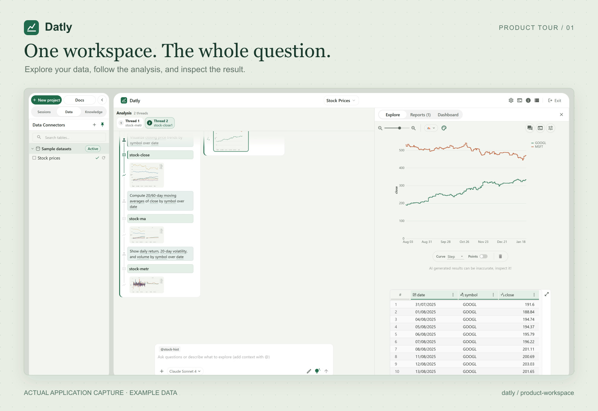
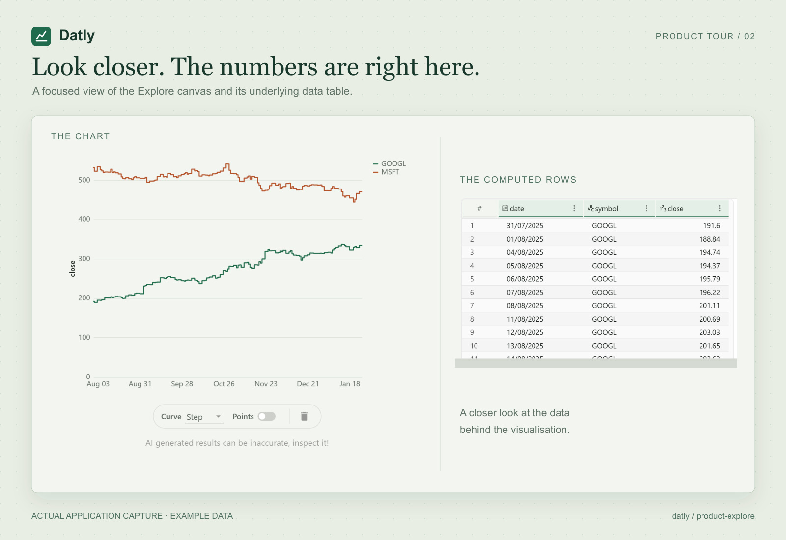
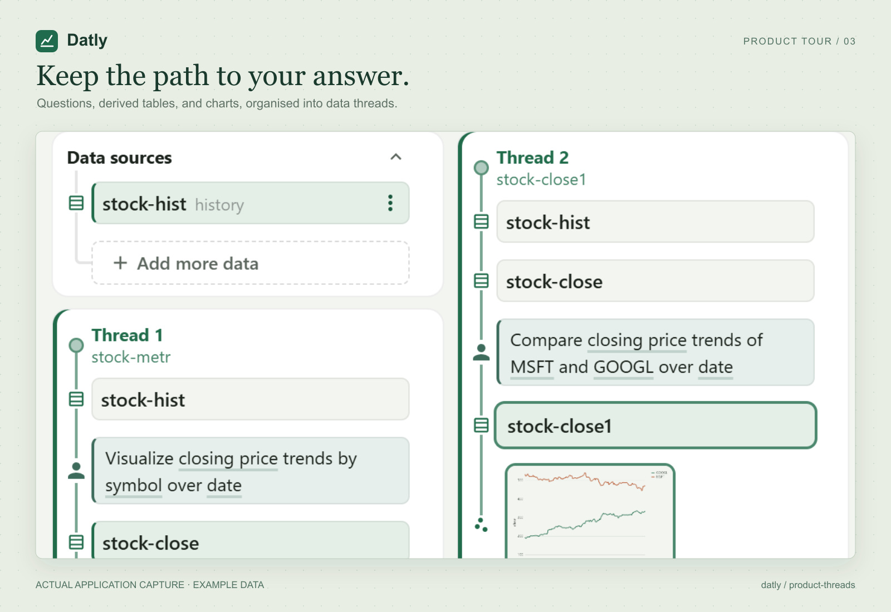
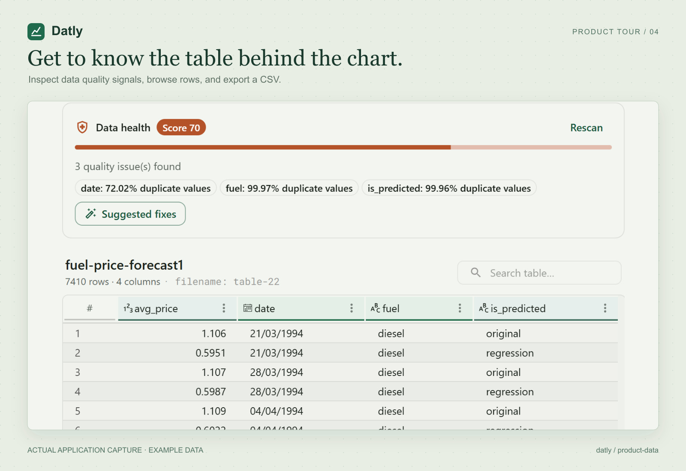
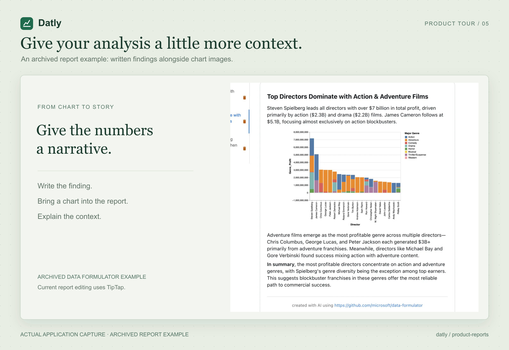

# Datly

An open-source analytics workspace for exploring tables with AI, refining charts, inspecting computed rows, and writing reports. Built on [Microsoft Research’s Data Formulator](https://github.com/microsoft/data-formulator).

[Product website](https://arpanjot-coding.github.io/Datly/) · [Setup](#run-from-source) · [Releases](https://github.com/arpanjot-coding/Datly/releases) · [MIT licence](LICENSE)



## What you can do

- Ask questions about data in natural language and follow up within a data thread.
- Refine visualisations through chart and encoding controls.
- Inspect the computed table behind a chart and export its rows as CSV.
- Organise prompts, transformations, derived tables, and charts in data threads.
- Edit rich-text reports with chart images; export a report image or print to PDF.
- Connect supported data sources or start with local files and example datasets.
- Configure a supported cloud model provider or a local Ollama endpoint.

Datly is in beta. AI-generated transformations and interpretations can be incorrect. Inspect the generated work, source data, and assumptions before relying on a result.

## Data handling and model requests

Transformations run in the environment hosting Datly. A local installation uses your computer; a server installation uses that server.

**Local execution does not mean AI requests contain only schema.** Model context can include field names, types, sample field values, sample rows, numerical statistics, prompts, and tool outputs. When you select a cloud model provider, that provider receives the context sent to it.

For example, [the context builder](py-src/data_formulator/agents/context.py) includes sample values and rows, and [the analyst agent](py-src/data_formulator/analyst/agent.py) incorporates that context. Do not rely on a “zero data exfiltration” or “schema-only” guarantee.

A locally hosted model endpoint can keep model requests local when configured accordingly. Remote connectors, web sources, and dependency downloads can still require network access. Review your deployment, selected endpoint, and data sources before using sensitive information.

## Run from source

You need Python 3.11 or later, Node.js, Yarn, and [uv](https://docs.astral.sh/uv/). Dependency and driver compatibility can vary by platform. The desktop CI uses Python 3.12 and Node.js 22.

Clone the repository:

```sh
git clone https://github.com/arpanjot-coding/Datly.git
cd Datly
```

Build the frontend:

```sh
yarn
yarn build
```

Install the Python environment and launch:

```sh
uv sync
uv run data_formulator
```

Open **http://localhost:5567**. The launch command assumes the frontend has already been built.

Configure a model in the application, or copy `.env.template` to `.env` and review the documented settings. Keep API keys and connection credentials out of version control.

On macOS or Linux:

```sh
cp .env.template .env
```

In PowerShell:

```powershell
Copy-Item .env.template .env
```

To use a different backend port:

```sh
uv run data_formulator --port 5568
```

### Development

Run the backend and frontend in separate terminals:

```sh
# Backend
uv run data_formulator --dev

# Frontend
yarn start
```

The Vite frontend uses http://localhost:5173 and proxies API requests to port 5567 by default. Set `API_PORT` when changing the backend port.

### Docker

Install Docker with Docker Compose, clone the repository, and copy `.env.template` to `.env` using the command for your shell above. Review the configuration, then run:

```sh
docker compose up --build
```

Open http://localhost:5567 after the services start. Building and dependency installation require network access.

### Desktop

See [releases](https://github.com/arpanjot-coding/Datly/releases) for currently published downloads.

The [desktop workflow](.github/workflows/desktop-build.yml) contains Windows x64 and macOS builds. Electron packaging configuration also exists in [package.json](package.json); a configured target is not proof that a downloadable binary is available. The repository’s beta package version is declared in [pyproject.toml](pyproject.toml).

## Supported data sources

The [loader registry](py-src/data_formulator/data_loader/__init__.py) declares implementations for:

- PostgreSQL, MySQL, Microsoft SQL Server, and ClickHouse.
- Databricks, BigQuery, AWS Athena, and Azure Data Explorer (Kusto).
- Amazon S3 and Azure Blob Storage.
- MongoDB and Azure Cosmos DB.
- Apache Superset datasets.
- Local folders, example datasets, and supported web sources.

File-loading paths include CSV, Excel, and Parquet. Registered loaders can be unavailable if their driver dependencies are missing. Connections require suitable credentials, permissions, and network access. Snowflake is not registered as a built-in loader in this version.

Optional browser rendering for web extraction needs the Python browser extra and Chromium:

```sh
uv sync --extra browser
uv run python -m playwright install chromium
```

## Models

The code includes provider handling for OpenAI, Azure OpenAI, Anthropic, Gemini, and Ollama. Configure your chosen model and credentials in the application. Availability and costs depend on the provider.

Ollama’s default local endpoint is http://localhost:11434. A local model still needs to be installed and running, and its capability affects the quality of generated transformations.

## Reports and dashboards

The report editor uses TipTap. Chart embeds are images, rather than interactive chart widgets. Report images can be exported; PDF uses the browser print flow.

The current dashboard implementation saves chart references and displays their type/title placeholders. It does **not** yet render an interactive multi-chart dashboard. See [DashboardView.tsx](src/views/DashboardView.tsx).

## Product images

[Browse and download the product image library](https://arpanjot-coding.github.io/Datly/images/).

The product graphics use actual application captures already present in this repository, with new crops, framing, and explanatory labels. Example data is illustrative. The report graphic is explicitly labelled as an archived example of the earlier Data Formulator interface; current report editing uses TipTap.









Image provenance is recorded in [SOURCES.txt](docs/images/SOURCES.txt). Source SVGs, web images, and high-resolution PNGs are included in the image library. Existing screenshot files remain available.

## Website development

The product website is a buildless static site in `docs/`. Preview it without installing the application:

It includes English, Russian, Simplified Chinese, Japanese, Vietnamese, Thai, Hindi, Arabic, French, German, Spanish, and Italian. Each language has a static HTML page with translated content and metadata, its own canonical URL, reciprocal `hreflang` links, and a sitemap entry. Arabic uses a right-to-left layout. Language selection is explicit; visitors are not redirected by IP or browser settings.

Edit `docs/assets/home.template` and the matching `docs/locales/*.json` files, then regenerate pages with `node docs/assets/build-locales.mjs`. Generated HTML stays usable and indexable without JavaScript. The interactive gallery and status messages use the same locale dictionaries.

The GitHub star count was verified as 249 on 2 November 2026. The site refreshes it through the public GitHub API and retains the dated count if the request fails or is rate-limited. Audience wording describes who Datly is built for; it does not claim verified customer adoption.

```sh
python -m http.server 4387 --bind 127.0.0.1 --directory docs
```

Open http://localhost:4387. GitHub Pages should publish the `docs/` directory. The site does not call an analytics or geolocation service. Product claims are based on repository source; connector presence does not represent a live end-to-end integration test.

## Licence and attribution

Datly is MIT licensed; see [LICENSE](LICENSE). It builds on Microsoft Research’s Data Formulator. Existing third-party screenshots and assets retain their original attribution. Model providers and connected infrastructure may have separate terms and costs.
