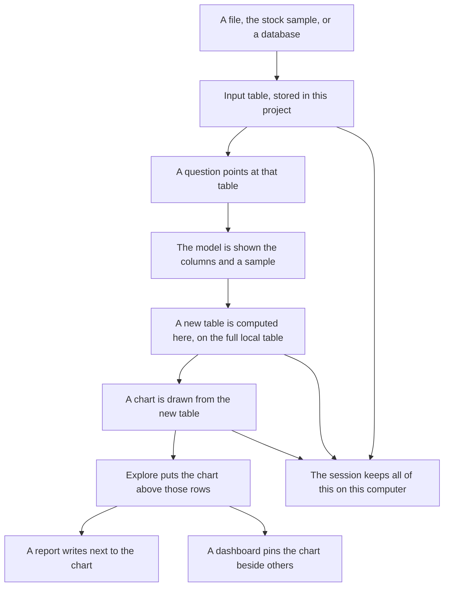
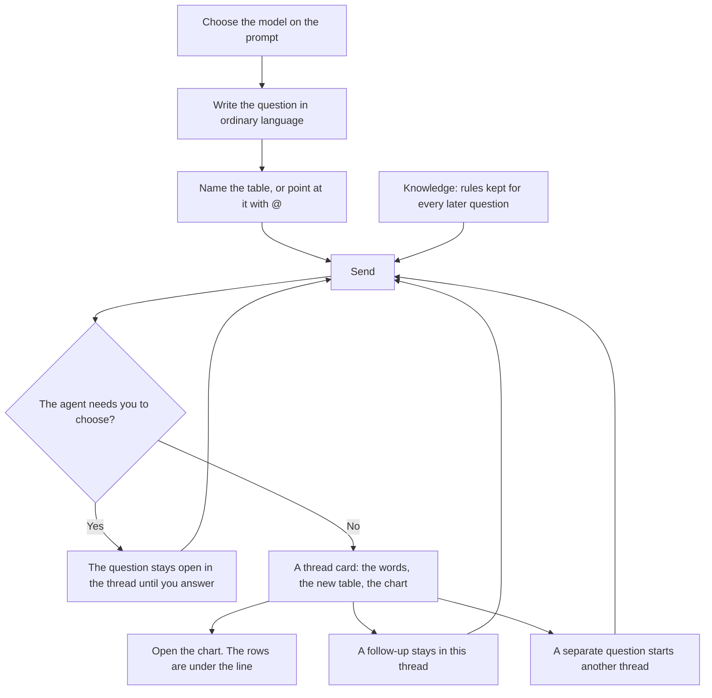

# Datly

A table can already hold the answer and still hide it. The rows are in one program, the chart gets made in another, and the question that joined them is gone. A smooth line can be wrong, and there is nothing next to it to check.

Datly is one project for that job. The table stays on this computer. The question is written in a sentence. The chart is drawn from a new table that the question produced, and that table stays on the screen under the line.

The picture is the app doing that job. The diagrams under it are the two paths through the window: where the rows go, and where a question goes.


In that window the project is named Stock Prices. Sample datasets is connected and Stock prices is ticked, so the rows are in the project. Two questions have already been asked. Thread 2 is open on the right: closing price for GOOGL and MSFT, with the rows of that result underneath the line. Thread 1, still in the middle, is the earlier question about returns and moving averages. The prompt at the bottom is aimed at `@stock-hist`, ready for the next sentence.

## Where the data goes

A row does not become a chart by being pasted into a chat. It stays a table, and each question adds another table.



**The rows arrive once.** On the left of the picture, Data is open. Sample datasets is Active, and Stock prices has a tick. That tick means the file has been copied into this project as a table you can name. The sample that ships with the app is 6,000 daily prices, 30 September 2024 through 28 September 2026, for twelve large US companies. The columns are date, symbol, company, sector, open, high, low, close, and volume. Prices are adjusted for splits. The source of the file is Yahoo Finance. A spreadsheet uses the plus on the rail, or Add more data inside a thread. A database uses the plus beside Data Connectors. After that, the original connection is not required to read the chart. The project has its own copy.

**The input table is not replaced.** In the middle, `stock-hist` is still the history. The questions did not overwrite it. `@stock-hist` in the prompt is that table. Later questions can point at it again, or at a table a previous question made.

**A question computes a new table.** The model does not draw the line from a handful of sample cells and then throw the rest away. It is shown the column names, a short sample, and the question. It writes the step that builds the result. That step runs on the table in the project. The result is a new table with its own name.

In the picture those new tables are the cards. `stock-close` is the closing-price table. `stock-ma` is the moving-average table, from the question written above it: 20-day and 60-day averages of close, by symbol. `stock-metr` is the returns table, from the question about daily return, 20-day volatility, and volume. Each card is a table you can open. The small chart on the card is drawn from that table, not from the original file by eye.

**The canvas reads the new table, not a picture.** On the right, Explore is the check. The green line is GOOGL and the orange line is MSFT, and the grid under them is the close, the date, and the symbol for the same result. The first row on screen is GOOGL on 31 July 2025 at 191.6, which is where the green line starts. If the line were saved as an image in another tool, that row would have to be found again by hand. Here the grid is the table the line was drawn from. Download CSV writes that table out. Quick chart, when the grid is what you are looking at, sits under the rows rather than on top of them.

**A report and a dashboard do not make another copy of the file.** Reports (1) is writing placed next to charts that already exist in the project. Dashboard pins those charts so more than one stays in view. Closing the canvas does not delete the tables. They remain cards in the thread.

**The session is the project.** New project clears the screen. It does not delete this work. Sessions, on the left, is the list of projects kept on this computer: the input tables, the derived tables, the charts, and the reports.

## Where a question goes

The prompt is not a separate chat that forgets the project. A sentence goes into a thread, the thread owns the new table, and the next sentence can see that thread.



**The model is chosen before the sentence.** In the picture the menu on the prompt says Claude Sonnet 4. That is the model that will read the question. Changing it changes who answers the next send. It does not rewrite the threads already on screen.

**The sentence has to name a table.** `@stock-hist` means this question is about the history table, not whichever card happens to be selected. You can also type the table's name. A question that names the columns is the one that produced the picture: closing price by date, for two symbols. The words of that question remain in the thread after the chart exists. They are not replaced by the chart.

**Knowledge is attached to the send, not typed again.** The bulb on the left opens the rules. Those rules are standing instructions for the agent, for code it writes and for how it explores. They apply to later questions in this project. They are not a second chat.

**If the agent cannot tell what you meant, it asks, and the thread waits.** The question does not vanish into an error and it does not get answered with a guess you cannot see. It stays in the thread until you pick. Sending again continues from that question.

**The answer is a card in a thread, not a message that scrolls away.** Thread 1 in the picture is one chain: a close chart, then the moving-average question, then `stock-ma`, then the returns question, then `stock-metr`. Thread 2 is the other chain, `stock-close1`, and it is the one open on the canvas. The green pill on Thread 2 means the canvas is showing that thread. Clicking the other pill shows the other chain. Neither chain is deleted to show the other.

**A follow-up stays on the chain you have open.** Asking "now only Apple" from Thread 2 continues Thread 2. The new table is computed from the tables that thread already has, and the words sit under the earlier cards. A question about a different comparison, asked as its own subject, becomes another thread, the way Thread 1 and Thread 2 are both still in this project.

**Opening the card is the check, not a new question.** Clicking the chart fills Explore. Curve, Step, and Points only change how the same table is drawn. The sentence under the plot, that a generated result can be wrong, is why the grid is there. Reports and Dashboard are places to keep the chart after you have read the rows. They are not where the table is computed.

## How to run

Python 3.11 or newer, Node.js 20 or newer, Yarn, and [uv](https://docs.astral.sh/uv/) or pip.

```bash
yarn
yarn build
uv sync
uv run data_formulator
```

For work on the interface, run the API in one terminal and the page in another.

```bash
uv run data_formulator --dev
yarn start
```

Open http://localhost:5173. On Windows, `local_server.bat` starts the local server. On Unix, `./local_server.sh`.

Copy `.env.template` to `.env` for the language-model keys. `.env` is not in this repository.
