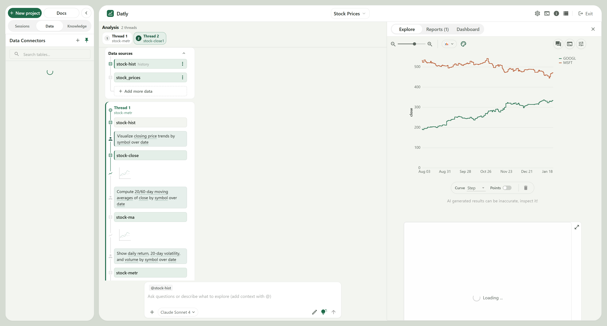
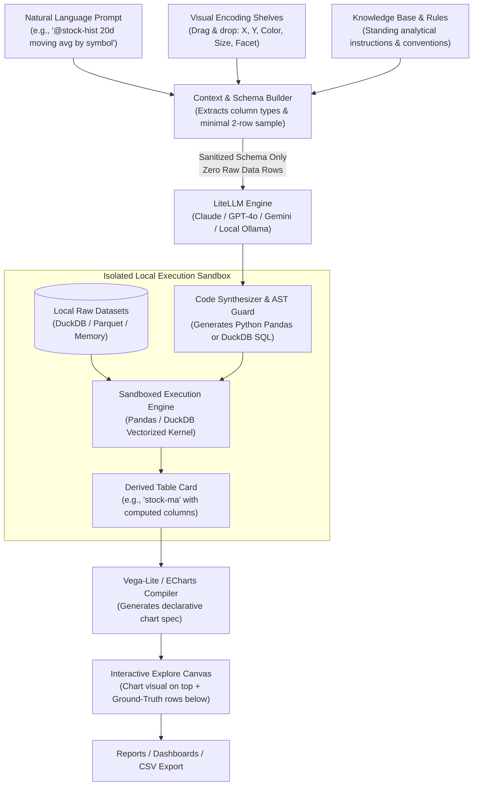
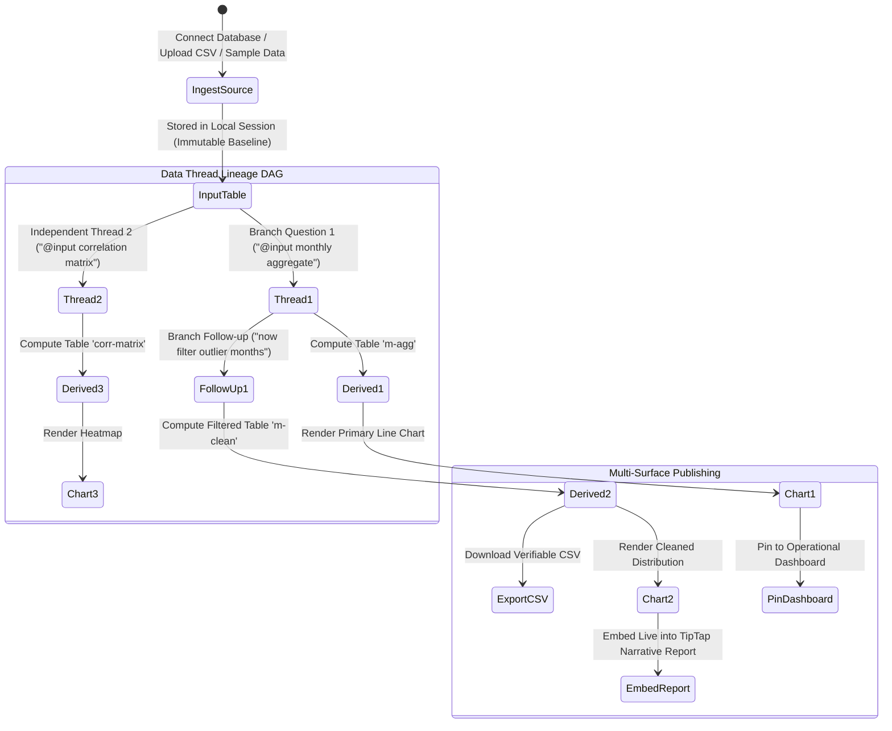
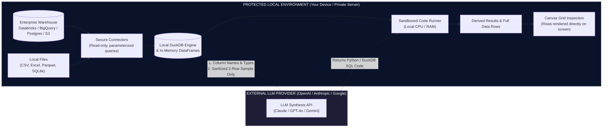
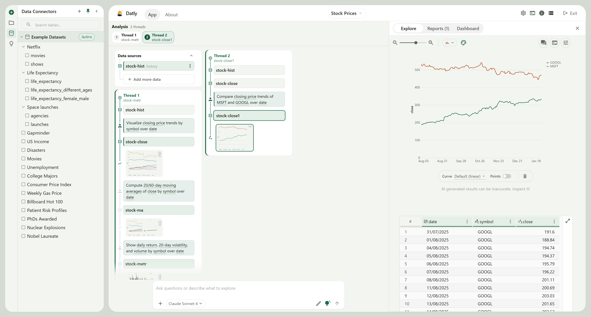
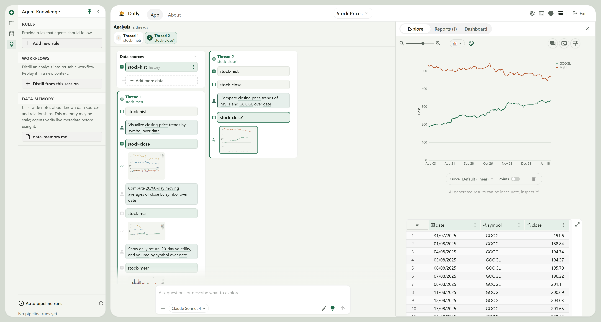
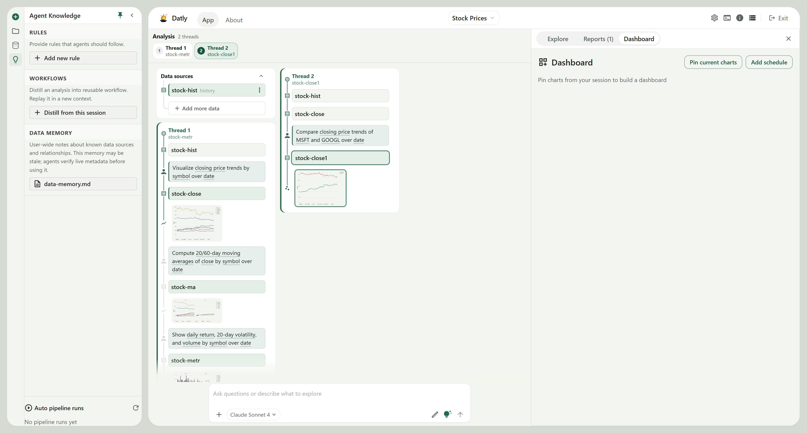
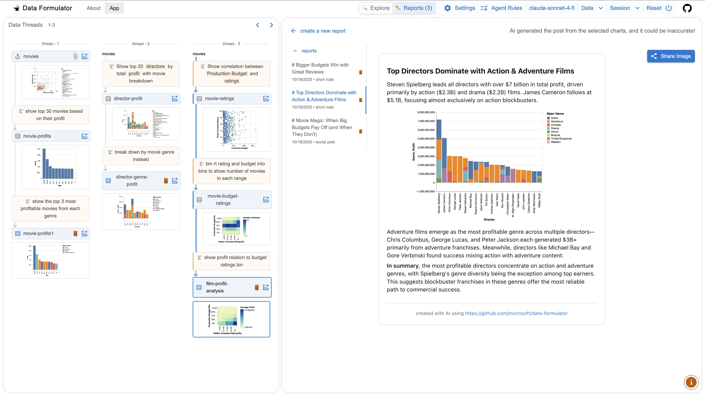
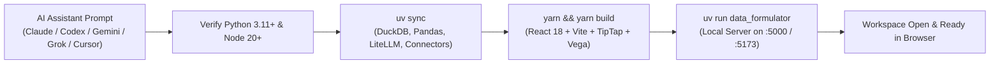

# Datly — AI-Powered Interactive Data Visualization IDE & Analytical Workbench

**Local-First, Ground-Truth Verifiable Data Exploration with Concept Encoding, Data Threads & Enterprise Warehouse Connectors**

<div align="left" style="display: flex; flex-wrap: wrap; gap: 6px; align-items: center; margin: 12px 0;">
  <a href="https://github.com/arpanjot-coding/Datly/releases"></a>
  <a href="LICENSE"></a>
  <a href="https://python.org"></a>
  <a href="https://nodejs.org"></a>
  <a href="https://duckdb.org"></a>
  <a href="https://vega.github.io/vega-lite/"></a>
  <a href="https://www.electronjs.org"></a>
  <a href="https://github.com/arpanjot-coding/Datly/stargazers"></a>
</div>

<div align="center" style="margin: 20px 0;">
  <a href="https://arpanjot-coding.github.io/Datly/"><strong>🌐 Visit Official Interactive Showcase & Documentation</strong></a> &nbsp;|&nbsp;
  <a href="#-quick-start-1-prompt-automated-setup-via-ai-assistants-recommended"><strong>⚡ 1-Prompt Agent Quickstart</strong></a> &nbsp;|&nbsp;
  <a href="#-enterprise-data-connectors--integrations"><strong>🔌 Enterprise Connectors (15+)</strong></a>
</div>

<p align="center">
  
</p>

---

## 🛡️ Critical Data Governance, Privacy & Trust Notice

> [!IMPORTANT]
> ### 100% LOCAL-FIRST DATA PROCESSING & ZERO CLOUD DATA EXFILTRATION
>
> In traditional AI data exploration tools and cloud notebooks, analysts are forced to upload raw proprietary datasets—including sensitive customer records, financial ledgers, and health information—to remote LLM servers.
>
> **Datly fundamentally breaks this security liability:**
> - **Zero Raw Data Uploaded:** Your underlying data tables, whether 100 rows or 10 million rows from DuckDB, Parquet, or connected enterprise warehouses, **never leave your local environment**.
> - **Schema-Only Synthesis:** When prompting with natural language (e.g. `@stock-hist calculate 20-day volatility`), Datly sends **only** column schemas and sanitized metadata to your chosen LLM (OpenAI, Claude, Gemini, DeepSeek, or offline local Ollama).
> - **Local Sandboxed Code Execution:** The synthesized data transformation code (DuckDB SQL / Python Pandas) executes strictly in-memory on your local machine.
> - **Verifiable Ground-Truth Inspection:** Every visual chart sits directly on top of the exact computed data table underneath it. What you see is what was mathematically derived—eliminating AI chart hallucinations and phantom metrics.

---

## 📑 Table of Contents

- [Executive Summary & Architectural Highlights](#-executive-summary--architectural-highlights)
- [Capability & Comparison Matrix](#-capability--comparison-matrix)
- [System Architecture & Data Flow Diagrams](#-system-architecture--data-flow-diagrams)
  - [1. Natural Language & Shelf-Based Synthesis Pipeline](#1-natural-language--shelf-based-synthesis-pipeline)
  - [2. Ground-Truth Data Thread Lineage & State Machine](#2-ground-truth-data-thread-lineage--state-machine)
  - [3. Local-First Zero-Data-Exfiltration Security Boundary](#3-local-first-zero-data-exfiltration-security-boundary)
  - [4. Multi-Tier Modular Software Architecture](#4-multi-tier-modular-software-architecture)
- [Enterprise Data Connectors & Integrations](#-enterprise-data-connectors--integrations)
- [Core Features in Detail](#-core-features-in-detail)
  - [1. Data Threads vs Linear Notebook Cells](#1-data-threads-vs-linear-notebook-cells)
  - [2. Concept Encoding & Interactive Visual Shelves](#2-concept-encoding--interactive-visual-shelves)
  - [3. Immediate Ground-Truth Verification (Explore Grid)](#3-immediate-ground-truth-verification-explore-grid)
  - [4. Standing Knowledge Base & Custom Analyst Rules](#4-standing-knowledge-base--custom-analyst-rules)
  - [5. WYSIWYG TipTap Narrative Reports & Pinboard Dashboards](#5-wysiwyg-tiptap-narrative-reports--pinboard-dashboards)
  - [6. Multi-Model Agnostic LLM Engine (LiteLLM)](#6-multi-model-agnostic-llm-engine-litellm)
  - [7. Desktop-First Identity & Offline Mode](#7-desktop-first-identity--offline-mode)
- [Visual Feature Gallery](#-visual-feature-gallery)
- [Quick Start: 1-Prompt Automated Setup via AI Assistants (Recommended)](#-quick-start-1-prompt-automated-setup-via-ai-assistants-recommended)
- [Alternative: Manual Build & Deployment Guide](#-alternative-manual-build--deployment-guide)
  - [Prerequisites](#prerequisites)
  - [Step-by-Step Installation (uv + Yarn)](#step-by-step-installation-uv--yarn)
  - [One-Click Launcher Scripts](#one-click-launcher-scripts)
  - [Docker Container Deployment](#docker-container-deployment)
  - [Electron Desktop Application Build](#electron-desktop-application-build)
- [Comprehensive Configuration & Environment Reference](#-comprehensive-configuration--environment-reference)
- [Threat Model & Security Analysis](#-threat-model--security-analysis)
- [Diagnostic & Troubleshooting Guide](#-diagnostic--troubleshooting-guide)
- [Frequently Asked Questions (FAQ) & SEO Discoverability](#-frequently-asked-questions-faq--seo-discoverability)
- [GitHub Repository SEO & Metadata Configuration](#-github-repository-seo--metadata-configuration)
- [Roadmap & Community](#-roadmap--community)
- [License](#-license)

---

## 🏛️ Executive Summary & Architectural Highlights

**Datly** is a next-generation AI-powered data visualization IDE and exploratory analytics workbench. Engineered for modern data analysts, business intelligence engineers, and researchers, Datly unifies declarative concept encoding, conversational data transformations, and automated report synthesis into a single cohesive workspace.

Traditional analysis workflows are fragmented across three incompatible silos:
1. **Spreadsheets & SQL IDEs (DBeaver, DataGrip):** Strong at tabular data inspection, but lacking visual narrative, exploratory iteration, and automated reasoning.
2. **Computational Notebooks (Jupyter, Hex):** Suffer from hidden state traps, fragile linear cell ordering, and friction when communicating findings to non-technical stakeholders.
3. **Legacy BI Platforms (Tableau, Power BI):** Rigid data modeling requirements, steep learning curves for ad-hoc formulas, and high license friction.

Datly eliminates this fragmentation by pairing **high-speed local in-memory engines (DuckDB + Pandas)** with **agentic code synthesis**, **visual encoding shelves**, **non-destructive threaded data lineage**, and **instant ground-truth verification**.

### Core Pillars
1. **Local-First In-Memory Analytics:** Executes blazingly fast SQL and Python transformations on your machine using DuckDB and PyArrow. Large raw tables stay local; sensitive datasets are protected by design.
2. **Ground-Truth Verifiability:** Unlike AI chat tools that spit out unverified chart images, Datly renders visualizations directly from a tangible derived table. The exact rows powering the chart sit immediately underneath the visual canvas for continuous verification.
3. **Dual-Mode Synthesis (Natural Language + Visual Shelves):** Ask complex questions in plain natural language (e.g., using `@table-name` mentions), or fine-tune charts using drag-and-drop visual encoding shelves (X, Y, Color, Size, Facet, Repeat).
4. **Non-Destructive Threaded Lineage (Data Threads):** Branch out questions into isolated threads. Each analytical question creates a persistent, named derived dataset card without mutating the original input data.
5. **Multi-Surface Deliverables:** Seamlessly pin charts into executive dashboards or embed live chart components into TipTap WYSIWYG rich text reports with PDF, PNG, SVG, and CSV export.
6. **Enterprise Ecosystem Ready:** Connects to 15+ data sources (Databricks, BigQuery, Snowflake, ClickHouse, Postgres, S3, MongoDB, Web Scrapers) and supports any LLM (Claude 3.7/Sonnet, GPT-4o, Gemini, DeepSeek, or local Ollama).

---

## 📊 Capability & Comparison Matrix

| Feature / Architectural Control | Jupyter / Traditional Notebooks | Cloud BI (Tableau / Power BI) | SQL IDEs (DBeaver / DataGrip) | **Datly Analytics IDE** |
| :--- | :---: | :---: | :---: | :---: |
| **Natural Language AI Synthesis** | ⚠️ Plugin-dependent | ⚠️ Limited Copilot / Costly | ❌ None or Basic Autocomplete | ⚡ **Native Grounded Agent (`@table`)** |
| **Ground-Truth Data Table Under Chart** | ❌ Separate cell output | ❌ Deeply nested view | ❌ Manual query required | 🛡️ **Always Visible on Canvas** |
| **Dual-Mode (Encoding Shelf + Agent)** | ❌ Code only | ⚠️ Shelves only (No Agent) | ❌ Code only | ✅ **Bi-Directional Shelves + Agent** |
| **Local Data Privacy (Zero Exfiltration)** | ✅ Local | ❌ Cloud ingestion required | ✅ Local | 🔒 **100% Local (Schema-Only to LLM)** |
| **Data Lineage Architecture** | ❌ Linear, stateful cell traps | ❌ Static data models | ❌ Session query history | 🌲 **Branching Data Threads (DAG)** |
| **In-Memory Analytical Engine** | ⚠️ Depends on kernel | ⚠️ Proprietary VertiPaq/Hyper | ❌ Remote DB dependent | ⚡ **DuckDB + Pandas + PyArrow** |
| **Interactive WYSIWYG Reporting** | ❌ Markdown cells only | ⚠️ Heavy dashboard canvas | ❌ None | 📝 **TipTap Narrative Rich-Text Editor** |
| **Automated Web Table Scraping** | ❌ Manual scraping scripts | ❌ Not supported | ❌ Not supported | 🌐 **Built-in Playwright & lxml Scraper** |
| **Model Independence (BYOK)** | ⚠️ Manual configuration | ❌ Locked to vendor cloud | ❌ N/A | 🔓 **LiteLLM (Claude, GPT, Gemini, Ollama)** |
| **Desktop Deployment Mode** | ⚠️ Browser localhost | ⚠️ Heavy desktop app | ✅ Desktop native | 📦 **Native Electron + Web + Docker** |

---

## 📐 System Architecture & Data Flow Diagrams

### 1. Natural Language & Shelf-Based Synthesis Pipeline



---

### 2. Ground-Truth Data Thread Lineage & State Machine



---

### 3. Local-First Zero-Data-Exfiltration Security Boundary



---

### 4. Multi-Tier Modular Software Architecture

```mermaid
graph TD
    subgraph Presentation_Tier["Presentation Tier (React 18 + TypeScript + Vite)"]
        UI_Threads["Data Thread Cards & Prompt Rail\n(Conversational branching & @mentions)"]
        UI_Shelves["Visual Encoding Shelves\n(Drag & drop field encodings)"]
        UI_Canvas["Explore Canvas & Data Grid\n(Synchronized chart + tabular rows)"]
        UI_Editor["TipTap Report Editor\n(WYSIWYG narrative + embedded charts)"]
        UI_Dash["Dashboard Pinboard\n(Multi-card layout & live filters)"]
    end

    subgraph Analytical_Engine_Tier["Analytical Engine Tier (Python Backend)"]
        API_Server["Flask REST API & WebSockets\n(CORS-protected, session-managed)"]
        LiteLLM_Hub["LiteLLM Unified Adapter\n(Multi-model provider routing)"]
        Transform_Exec["Vectorized Transformation Engine\n(DuckDB SQL & Pandas execution)"]
        Web_Scraper["Playwright & lxml Web Scraper\n(Automated table discovery)"]
    end

    subgraph Data_Connector_Tier["Enterprise Connector Tier (15+ Sources)"]
        Conn_Cloud["Databricks / BigQuery / Kusto / S3 / Athena"]
        Conn_RDBMS["PostgreSQL / MySQL / MSSQL / ClickHouse"]
        Conn_NoSQL["MongoDB / Azure CosmosDB / Azure Blob"]
        Conn_Files["Excel (.xlsx) / Parquet / CSV / yfinance"]
    end

    subgraph Desktop_Platform_Tier["Packaging & Runtime Tier"]
        Pkg_Electron["Electron 43 Desktop Wrapper (Win / macOS / Linux)"]
        Pkg_PyWebView["PyWebView Lightweight Desktop Engine"]
        Pkg_Docker["Docker & Docker Compose Containerization"]
    end

    Presentation_Tier --> Analytical_Engine_Tier
    Analytical_Engine_Tier --> Data_Connector_Tier
    Desktop_Platform_Tier --> Presentation_Tier
    Desktop_Platform_Tier --> Analytical_Engine_Tier
```



---

## 🔌 Enterprise Data Connectors & Integrations

Datly features native, high-performance connectors with read-only parameterization and schema discovery:

| Category | Supported Connector | Technology / Driver | Capability & Protocol |
| :--- | :--- | :--- | :--- |
| **Cloud Lakehouse** | **Databricks** | `databricks-sql-connector` | High-concurrency SQL Warehouse queries, Delta tables |
| **Cloud Warehouse** | **Google Cloud BigQuery** | `google-cloud-bigquery` | Service Account & OAuth authentication, nested fields |
| **Cloud Telemetry** | **Azure Data Explorer (Kusto)** | `azure-kusto-data` | KQL queries, fast time-series ingestion |
| **Serverless Query** | **AWS Athena & S3** | `boto3` | Direct Parquet / CSV S3 bucket queries via Presto engine |
| **High-Scale OLAP** | **ClickHouse** | `clickhouse-connect` | Vectorized analytical queries on billions of rows |
| **Relational SQL** | **PostgreSQL** | `psycopg2-binary` | Full schema browsing, SSL mode, parameterized queries |
| **Relational SQL** | **MySQL / MariaDB** | `pymysql` | Standard connection pooling, transactional inspection |
| **Relational SQL** | **Microsoft SQL Server (MSSQL)** | `mssql-python` | Windows Auth / SQL Auth, enterprise schemas |
| **Document NoSQL** | **MongoDB** | `pymongo` | JSON document extraction & automatic tabular flattening |
| **Cloud NoSQL** | **Azure Cosmos DB** | `azure-cosmos` | NoSQL API support, partitioned collection loading |
| **Cloud Storage** | **Azure Blob Storage** | `azure-storage-blob` | SAS token & Azure Identity managed parquet/csv loading |
| **BI Platforms** | **Apache Superset** | Superset REST API | Direct dataset import and dashboard chart mirroring |
| **Market Data** | **Yahoo Finance (`yfinance`)** | `yfinance` | Live historical ticker prices, financial statements, dividends |
| **Spreadsheets** | **Excel & OpenDocument** | `openpyxl` / `xlrd` | Multi-sheet detection, header inference, formula evaluation |
| **Web Scraping** | **Web Table Scraper** | `playwright` + `lxml` | Automated headless extraction of tables from live web URLs |

---

## 🔒 Core Features in Detail

### 1. Data Threads vs Linear Notebook Cells
Traditional notebooks execute sequentially top-to-bottom. If you re-run an earlier cell or branch an exploration, you overwrite the notebook's global state and risk corrupting subsequent calculations.
- Datly introduces **Data Threads**: each thread is an isolated analytical lineage branch.
- Asking a follow-up question builds directly on that thread's intermediate state.
- Starting a new thread branches cleanly from the original source without altering prior discoveries.
- Every thread card retains its natural language prompt, generated code, derived dataset, and visual representation.

### 2. Concept Encoding & Interactive Visual Shelves
Datly unites the declarative expressive power of the Grammar of Graphics with AI automation:
- **Encoding Shelves:** Drag and drop data fields into shelves: **X-Axis**, **Y-Axis**, **Color (Grouping)**, **Size**, **Shape**, **Facet (Trellis)**, and **Repeat**.
- **Bi-Directional Synchrony:** Prompting the agent automatically updates the encoding shelves. Modifying an encoding shelf instantly adapts the Vega-Lite visualization without requiring an LLM round-trip.
- **Rich Chart Gallery:** Scatter, multi-series line, stepped curves, grouped bars, area charts, heatmaps, box plots, and geographic coordinates.

### 3. Immediate Ground-Truth Verification (Explore Grid)
AI models can occasionally hallucinate aggregations or generate deceptive charts from misinterpreted data.
- In Datly, the **Explore Canvas** guarantees transparency: clicking any chart card opens the full interactive visualization with the **exact computed data table displayed directly underneath**.
- Inspect individual rows, sort columns, and confirm mathematical transformations with your own eyes.
- Use **Download CSV** to immediately export the derived table, or click **Quick Chart** to instantly visualize subsets.

### 4. Standing Knowledge Base & Custom Analyst Rules
Datly allows you to establish continuous domain context without repeating instructions in every prompt:
- **Knowledge Rules Panel:** Define project-wide analytical rules (e.g., *"Fiscal year begins in April"*, *"Exclude cancelled orders where status = 'CANC'"*, *"Always format currency in USD thousands"*).
- Rules are automatically injected into the synthesis context for all subsequent prompt turns.
- Configure organization-specific color palettes, default aggregations, and business logic.

### 5. WYSIWYG TipTap Narrative Reports & Pinboard Dashboards
Turn raw analytical discoveries into executive-ready communication artifacts:
- **Narrative Reports:** A built-in TipTap rich-text editor supporting headings, formatted tables, code snippets, callouts, and live embedded charts that stay dynamically linked to their underlying data threads.
- **Pinboard Dashboards:** Pin multiple charts side-by-side to construct live, interactive operational dashboards.
- **High-Fidelity Export:** One-click export to standalone PDF documents, presentation-ready PNG/SVG graphics, and clean CSV datasets.

### 6. Multi-Model Agnostic LLM Engine (LiteLLM)
Never get locked into a single AI provider:
- Powered by **LiteLLM**, Datly seamlessly connects to **Anthropic Claude (3.7 Sonnet, 3.5 Sonnet)**, **OpenAI (GPT-4o, o1, o3-mini)**, **Google Gemini (2.5 Pro, 2.0 Flash)**, **DeepSeek (R1, V3)**, **Mistral**, **Groq**, and **Azure OpenAI**.
- **Offline / Local Inference:** Full support for local models via **Ollama**, **vLLM**, or **LocalAI**—enabling completely air-gapped, zero-internet data exploration.

### 7. Desktop-First Identity & Offline Mode
Datly is engineered as a true daily-driver desktop IDE:
- Native **Electron application** with dedicated OS menus, hardware acceleration, and system tray integration.
- Cross-platform binaries for **Windows (.exe / NSIS)**, **macOS (.dmg / Apple Silicon & Intel)**, and **Linux (.AppImage / .deb)**.
- Lightweight **PyWebView mode** and zero-dependency local browser serving (`http://localhost:5173`).

---

## 🖼️ Visual Feature Gallery

<table width="100%">
  <tr>
    <td width="50%" align="center">
      
      <br /><strong>15+ Data Lake & Warehouse Connectors</strong>
    </td>
    <td width="50%" align="center">
      
      <br /><strong>Ground-Truth Data Grid Under Chart</strong>
    </td>
  </tr>
  <tr>
    <td width="50%" align="center">
      
      <br /><strong>Multi-Chart Pinboard Dashboards</strong>
    </td>
    <td width="50%" align="center">
      
      <br /><strong>WYSIWYG TipTap Narrative Reports</strong>
    </td>
  </tr>
</table>

---

## 🚀 Quick Start: 1-Prompt Automated Setup via AI Assistants (Recommended)

Configuring full-stack data applications manually requires setting up Python 3.11+ virtual environments, compiling frontend TypeScript bundles, linking DuckDB native libraries, and installing data connectors.

Modern agentic AI coding assistants—including **Claude Code**, **OpenAI Codex**, **Google Gemini**, **xAI Grok**, and **Cursor**—can initialize and launch Datly in a single automated step.

### Universal AI Agent Prompt

Open your AI coding assistant in this repository directory and paste the following prompt:

```text
Set up and launch Datly: synchronize Python dependencies using uv (or pip), install frontend packages via yarn, compile the production bundle, and launch the Datly analytical workspace on localhost.
```

### What AI Assistants Execute Automatically:


---

## 🛠️ Alternative: Manual Build & Deployment Guide

### Prerequisites
- **Python:** Version `3.11`, `3.12`, or `3.13`
- **Node.js:** Version `20.x` or newer (`node -v`)
- **Yarn:** Package manager (`npm install -g yarn`)
- **uv:** Modern high-speed Python package manager ([Astral uv](https://docs.astral.sh/uv/)) or standard `pip`

---

### Step-by-Step Installation (uv + Yarn)

1. **Clone the Repository:**
   ```bash
   git clone https://github.com/arpanjot-coding/Datly.git
   cd Datly
   ```

2. **Configure API Keys:**
   Create your local `.env` configuration file from the template:
   ```bash
   cp .env.template .env
   ```
   Add your preferred model provider keys (e.g. `ANTHROPIC_API_KEY`, `OPENAI_API_KEY`, or configure local Ollama).

3. **Install & Build Frontend Assets:**
   ```bash
   yarn
   yarn build
   ```

4. **Synchronize Python Analytical Engine:**
   - **Using uv (Recommended for 10x faster setup):**
     ```bash
     uv sync
     uv run data_formulator
     ```
   - **Using standard pip / venv:**
     ```bash
     python -m venv .venv
     source .venv/bin/activate  # Windows: .venv\Scripts\activate
     pip install -e .
     data_formulator
     ```

5. **Access the Workspace:**
   Open your browser to: **`http://localhost:5567`** (or **`http://localhost:5173`** during development).

---

### One-Click Launcher Scripts

Datly provides turnkey launcher scripts for instant zero-configuration startup:
- **Windows:** Double-click `local_server.bat`
- **macOS / Linux:** Execute `./local_server.sh`

For active frontend or backend development with Hot Module Replacement (HMR):
```bash
# Terminal 1: Backend API with hot-reload
uv run data_formulator --dev

# Terminal 2: Vite Frontend Dev Server
yarn start
```

---

### Docker Container Deployment

Deploy Datly as an isolated, self-hosted container on local hardware or private enterprise clusters:

```bash
# Build and run with Docker Compose
docker-compose up --build -d

# Open workspace in your browser
# URL: http://localhost:5567
```

---

### Electron Desktop Application Build

Compile Datly into native standalone desktop installers:

```bash
# Build native desktop package (Windows .exe, macOS .dmg, Linux .AppImage)
yarn electron:build
```
Compiled installers will be placed in the `release-electron/` directory.

---

## ⚙️ Comprehensive Configuration & Environment Reference

| Environment Variable / Flag | Description | Default | Example / Options |
| :--- | :--- | :---: | :--- |
| `PORT` / `-p, --port` | Port for the local analytical API server | `5567` | `5567`, `8080` |
| `HOST` / `--host` | Network interface binding | `127.0.0.1` | `0.0.0.0` (for container / LAN access) |
| `SANDBOX` / `--sandbox` | Code execution environment backend | `local` | `local` (subprocess), `docker` |
| `DATA_FORMULATOR_HOME` / `--data-dir` | Workspace and persistent sessions root | `~/.data_formulator` | `/custom/path/to/data` |
| `MAX_DISPLAY_ROWS` / `--max-display-rows` | Maximum rows sent to UI for table inspection | `10000` | `1000`, `5000`, `10000` |
| `DISABLE_CUSTOM_MODELS` | Restrict LLMs to server-configured endpoints | `false` | `true`, `false` |
| `DISABLE_DATA_CONNECTORS` | Disable external database connector tabs | `false` | `true`, `false` |
| `FLASK_SECRET_KEY` | Session encryption entropy secret | *Auto-generated* | `hex-encoded-entropy-string` |
| `ANTHROPIC_API_KEY` | Anthropic Claude API Key | *None* | `sk-ant-api03-...` |
| `OPENAI_API_KEY` | OpenAI API Key | *None* | `sk-proj-...` |
| `GEMINI_API_KEY` | Google Gemini API Key | *None* | `AIzaSy...` |
| `OLLAMA_API_BASE` | Local Ollama endpoint for offline synthesis | `http://localhost:11434` | `http://127.0.0.1:11434` |

---

## 🛡️ Threat Model & Security Analysis

| Threat Vector | Potential Impact | Datly Technical Mitigation |
| :--- | :--- | :--- |
| **Raw Data Exfiltration to LLM Cloud** | Sensitive corporate or customer PII leaked to public model endpoints. | **Zero Raw Data Transfer:** Only column identifiers and a minimal 2-row sanitized preview are sent for code synthesis. Full datasets remain 100% local in DuckDB memory. |
| **Model Hallucination & Phantom Trends** | Business decisions made on false chart graphics generated by AI. | **Ground-Truth Data Canvas:** Charts are rendered strictly from local computed tables that remain open on screen under the visual. What you see is mathematically verified. |
| **Arbitrary Code Execution via AI** | Malicious or destructive scripts generated during prompt evaluation. | **AST Validation & Sandboxed Execution:** Synthesized transformation code is parsed into abstract syntax trees (AST) and executed within isolated in-memory Python / DuckDB processes. |
| **Credential & Connection String Leakage** | Database credentials or lakehouse secrets exposed in plain text. | All database connection strings and credentials are saved locally in private OS-level keystores or `.env` files; they are never logged or passed to LLM prompts. |
| **Cross-Site Scripting (XSS) in Reports** | Injected malicious code via shared analytical narrative documents. | **DOMPurify Sanitization:** All markdown, HTML, and TipTap report bodies undergo strict DOMPurify filtering before canvas rendering. |

---

## 🔧 Diagnostic & Troubleshooting Guide

| Symptom / Error | Root Cause | Step-by-Step Remediation |
| :--- | :--- | :--- |
| **`uv: command not found`** | Astral uv is not installed on system PATH. | Install uv via `curl -LsSf https://astral.sh/uv/install.sh \| sh` (macOS/Linux) or `powershell -c "irm https://astral.sh/uv/install.ps1 \| iex"` (Windows), or fallback to standard `pip install -e .`. |
| **`Playwright browser executable missing`** | Headless browser dependencies not installed for Web Scraper. | Run `uv run python -m playwright install chromium` or `python -m playwright install chromium`. |
| **`DuckDB native compilation error`** | C++ runtime or binary mismatch on legacy OS. | Ensure Python 3.11+ is running. DuckDB provides pre-compiled universal wheels; update pip with `python -m pip install --upgrade pip`. |
| **`LLM Model Connection Timeout / 401`** | Expired, invalid, or missing API keys in `.env`. | Verify `.env` file exists in project root. Check that `ANTHROPIC_API_KEY` or `OPENAI_API_KEY` has valid active quota. |
| **`Port 5567 / 5173 already in use`** | Another background server instance is active. | Pass custom port flag: `uv run data_formulator --port 5568` or terminate conflicting process via `lsof -i :5567` / `netstat -ano`. |
| **Database Connection Refused** | Remote database firewall blocking local IP or missing SSL certificate. | Verify credentials and firewall whitelist. In connection configuration, toggle **SSL Mode** or verify tunnel settings. |

---

## 🔍 Frequently Asked Questions (FAQ) & SEO Discoverability

### What is Datly and how does it differ from Microsoft Data Formulator?
Datly is an open-source, full-lifecycle AI data IDE and analytical workbench built upon the revolutionary research foundations of Microsoft Research's Data Formulator. While the original research prototype focused primarily on concept encoding, Datly elevates the platform into a comprehensive, professional enterprise data workspace—introducing 15+ native cloud warehouse connectors (Databricks, BigQuery, Snowflake, Postgres), TipTap narrative WYSIWYG report publishing, multi-chart pinboard dashboards, local-first zero-exfiltration security guarantees, and native cross-platform desktop installers.

### Does Datly send my private database records to OpenAI or Anthropic?
**No.** Datly operates on a strict **local-first privacy architecture**. When you connect a database or load a CSV/Parquet file, the data is loaded directly into a local in-memory DuckDB database on your computer. When you ask a question using natural language, Datly transmits **only the column names and data types** (with an optional 2-row sanitized preview) to the LLM to write the query or transformation step. The resulting DuckDB SQL or Python code runs entirely on your local CPU. Your raw rows never leave your system.

### Can I run Datly completely offline without any internet connection?
**Yes.** Datly integrates natively with local LLM runners via **Ollama**, **vLLM**, or **LocalAI**. By setting `OLLAMA_API_BASE=http://localhost:11434` and running a capable local open-weights coding model (such as `qwen2.5-coder:14b`, `llama3.3:70b`, or `deepseek-coder`), you can perform end-to-end data analysis in an entirely air-gapped, zero-internet environment.

### How does Datly prevent AI chart hallucinations?
In conventional conversational analytics tools, AI models frequently guess summary numbers or directly generate misleading SVG/canvas images. In Datly, the AI is **never allowed to draw charts directly**. Instead, the AI writes verifiable code that executes on your real data to create a new, tangible **derived data table**. That derived table is displayed right on screen under the chart inside the **Explore Canvas**, allowing you to inspect the exact rows, formulas, and math supporting every visual insight.

### Can I export my visualizations and reports?
Yes. Datly supports multi-format production exports:
- **Data:** Export any derived table or transformed dataset to clean CSV with one click.
- **Charts:** Export visualizations as publication-quality SVG vectors or high-resolution PNG images.
- **Reports:** Export full TipTap narrative reports—complete with analysis text, embedded charts, and metrics—into standalone PDF documents or markdown.

### How does Datly compare to Hex, JupyterLab, Tableau, and Power BI?
- **vs JupyterLab / Hex:** Jupyter notebooks run in a sequential, linear, and mutable global namespace where re-running cells can create corrupt, irreproducible states. Datly uses non-destructive **Data Threads (DAG)**, so every question branches cleanly without overwriting upstream tables. Furthermore, Datly provides visual encoding shelves and an interactive data grid under every chart.
- **vs Tableau / Power BI:** Traditional BI tools require rigid semantic data modeling upfront, expensive proprietary cloud licenses, and steep learning curves for ad-hoc transformation calculations. Datly gives analysts immediate, flexible, code-level control through ordinary natural language, executes everything locally with DuckDB, and remains 100% open-source under the MIT license.
- **vs DBeaver / DataGrip:** While SQL IDEs excel at tabular queries, they lack visual narrative, exploratory AI reasoning, and integrated document synthesis. Datly combines the raw speed of a SQL IDE with the communication power of an executive analytics workbench.

### Which LLM models and providers are supported?
Datly utilizes **LiteLLM** as its universal model gateway, supporting over 100+ model configurations out of the box:
- **Anthropic:** Claude 3.7 Sonnet, Claude 3.5 Sonnet, Claude 3.5 Haiku
- **OpenAI:** GPT-4o, GPT-4o-mini, o1, o3-mini
- **Google:** Gemini 2.5 Pro, Gemini 2.0 Flash, Gemini 1.5 Pro
- **Open Weights & Air-Gapped:** DeepSeek-R1, DeepSeek-V3, Qwen 2.5 Coder, Llama 3.3 (via Ollama, vLLM, or LocalAI)
- **Enterprise Cloud:** Azure OpenAI Service, AWS Bedrock, Google Vertex AI, Groq, Mistral AI

---

## 🏷️ GitHub Repository SEO & Metadata Configuration

To maximize visibility on GitHub Search, Google, and Bing, configure the following metadata in your GitHub repository settings (**Code** > ⚙️ **About**):

- **Repository Description (158 chars):**
  ```text
  Open-source, local-first AI data visualization IDE & analytics workbench. Talk to tables, verify rows with DuckDB, and build reports. Zero data exfiltration.
  ```
- **Website URL:**
  ```text
  https://arpanjot-coding.github.io/Datly/
  ```
- **Topics / Tags (Recommended 20 tags):**
  ```text
  data-visualization, ai, duckdb, data-ide, llm, vega-lite, data-formulator, business-intelligence, python, analytics, data-science, electron, local-first, tiptap, exploratory-data-analysis, pandas, echarts, bi, ollama, sql-ide
  ```

---

## 🗺️ Roadmap & Community

- [x] High-performance DuckDB vectorized in-memory transformation engine
- [x] Branching Data Threads DAG for non-destructive analytical lineage
- [x] 15+ Enterprise data connectors (Warehouses, SQL, NoSQL, Web Scrapers)
- [x] WYSIWYG TipTap narrative reporting with live embedded visual cards
- [x] Cross-platform Electron desktop distribution (Windows, macOS, Linux)
- [ ] Direct export of Data Threads into production dbt & SQL models
- [ ] Collaborative real-time multi-analyst workspace syncing
- [ ] Direct GitHub PR publishing for analytical reports

---

## ⚖️ License

Datly is open-source software released under the **MIT License**.

```text
MIT License

Copyright (c) 2026 Datly Project & Contributors

Permission is hereby granted, free of charge, to any person obtaining a copy
of this software and associated documentation files (the "Software"), to deal
in the Software without restriction, including without limitation the rights
to use, copy, modify, merge, publish, distribute, sublicense, and/or sell
copies of the Software, and to permit persons to whom the Software is
furnished to do so, subject to the following conditions:

The above copyright notice and this permission notice shall be included in all
copies or substantial portions of the Software.

THE SOFTWARE IS PROVIDED "AS IS", WITHOUT WARRANTY OF ANY KIND, EXPRESS OR
IMPLIED, INCLUDING BUT NOT LIMITED TO THE WARRANTIES OF MERCHANTABILITY,
FITNESS FOR A PARTICULAR PURPOSE AND NONINFRINGEMENT. IN NO EVENT SHALL THE
AUTHORS OR COPYRIGHT HOLDERS BE LIABLE FOR ANY CLAIM, DAMAGES OR OTHER
LIABILITY, WHETHER IN AN ACTION OF CONTRACT, TORT OR OTHERWISE, ARISING FROM,
OUT OF OR IN CONNECTION WITH THE SOFTWARE OR THE USE OR OTHER DEALINGS IN THE
SOFTWARE.
```

---

<p align="center">
  <sub>Datly Project · High-Assurance Exploratory Analytics & Data Visualization IDE · Built for Modern Data Teams</sub>
</p>
