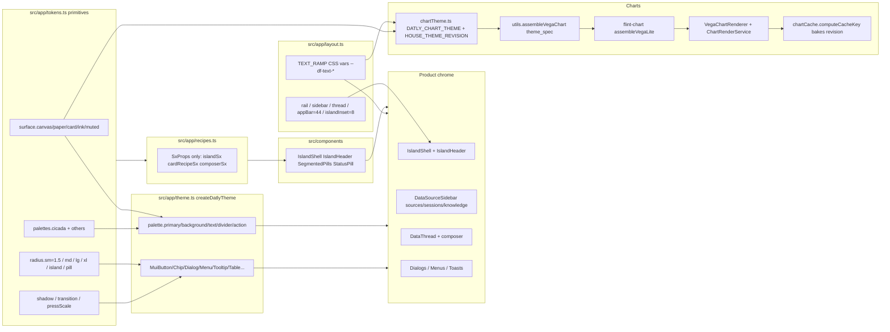
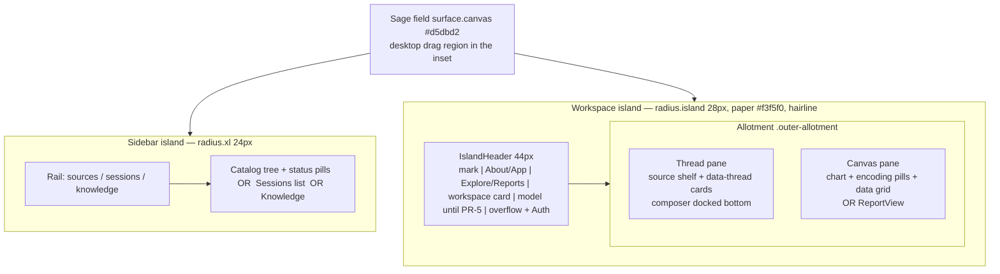

# Cicada Chrome + Chart Theme Redesign

| Field | Value |
|---|---|
| **Title** | Datly Cicada visual-language restyle (product chrome + charts) |
| **Author** | Datly design (writer) |
| **Date** | 2026-08-19 |
| **Status** | Draft |
| **Product** | Datly — AI data visualization workspace |
| **Scope** | Product chrome + Vega/Flint chart theme. Not a restack, not a rebrand campaign, not IDE-01. |

---

## Overview

Datly already ships a partial Cicada surface: sage canvas (`#d5dbd2`), cream paper (`#f3f5f0`), forest primary (`#1f6b4a`), `defaultPaletteKey = 'cicada'` in `src/app/tokens.ts`, MUI `createTheme` in `src/app/App.tsx` (~line 1500), and a house Vega theme `DATLY_CHART_THEME` in `src/app/chartTheme.ts`. The live app still reads as Data Formulator: a full-bleed 52px `AppBar`, leftover Material/Fluent blue hex, 3px/6px thread radii against 12px/16px tokens, a dense white thread-card wall, chart plots on stark white with a house categorical that is forest+terracotta then a sage cluster, Roboto still imported while the theme stack is Segoe UI, and Settings still offering copilot/orchid/electric.

This design restyles **product chrome and charts** to the Cicada editorial-light language (sage field, cream islands, one forest accent, concentric radii, hairline borders, almost no shadow, quiet motion) **without** copying Cicada’s IA (Preview/Codex/Design, Voice, credits, purple grid specimens). Datly stays catalog + data thread + chart/grid canvas; the agent remains a sidecar composer, not the only editor. The stack stays TypeScript + React 18 + Vite + **MUI** + Redux Toolkit + **Vega / Vega-Lite** via `flint-chart`. No Tailwind, no shadcn.

Highest-leverage order: tokens + leftover blue + island shell, then component recipes, then the house chart theme, then remaining screens.

---

## Background & Motivation

### Current state (what already matches)

- Surfaces in `src/app/tokens.ts`: `canvas #d5dbd2`, `paper #f3f5f0`, `card #ffffff`, `ink #1c231d`, `muted #5c665e`.
- Cicada palette: `palettes.cicada.primary.main = #1f6b4a`, `bgcolor #e4efe8`, `textColor #18563c`.
- Hairline borders (`borderColor.divider = rgba(28,35,29,0.10)`), quiet ink-tinted shadows, `pressScale.down = scale(0.96)`, 150–200ms `transition.*`.
- MUI already has `variant: 'soft'` and `variant: 'toolbar'` (`src/mui.d.ts`), AppBar is frosted paper not primary-filled, landing hero uses 44px/500/`-0.04em` type and a stacked `AgentChatInput`.
- Workspace content already sits in an inset rounded card (`DataFormulator.tsx` `fixedSplitPane`, `borderRadius: radius.md`, `backgroundColor: surface.card`).
- Charts assemble through `assembleVegaChart` → `flint-chart` `theme_spec: themeId ?? DATLY_CHART_THEME`.

### Pain points (Data Formulator heritage)

| # | Symptom | Evidence |
|---|---|---|
| 1 | Full-bleed 52px AppBar instead of header-inside-island | `App.tsx` `AppBar` + `Toolbar` `height: 52`. Layout token `REFERENCE.appBar` is 48 — live chrome and the layout book disagree. |
| 2 | Leftover Material blue selected tints | `DataSourceSidebar.tsx` `rgba(25, 118, 210, 0.055/.085)`; `VisualizationView.tsx` action hover `0.08`; `AgentRulesDialog.tsx` inset sash; `MarkdownEditor.tsx` caret `#1976d2` plus `rgba(25,118,210,0.045/0.16/0.08)`; `DataView.tsx` hover glow; `DataView.scss` header `#0288d1`; `MessageSnackbar.tsx` info + details link `#0288d1`; `VisualizationView.scss` `@keyframes bump` `rgba(2,136,209,0.2)`. Grep gate: `#007fd4|#0288d1|#1976d2|25, 118, 210`. Keep `#0078d4` / `#1565c0` inside `palettes.fluent` / `material`. |
| 3 | Fluent sash `--focus-border: #007fd4` | `src/scss/App.scss` `.outer-allotment` / `.inner-allotment` (Allotment default). |
| 4 | Radius inconsistency | Tokens today: `{ sm: 1.5 (6px), md: 3 (12px), lg: 4 (16px), pill }`. `radius.sm` is already used on encoding boxes, knowledge, upload, agent-rules, data-operation cards — **do not silently change 1.5→2**. Thread cards also hardcode `'3px'`/`'6px'`. Rectangular panes misuse `radius.pill` (999px): `DataFormulator.tsx` `borderBoxStyle` **and** `DataLoadingChat.tsx` ~1922 (“Same surface as the visualization pane”). MUI Paper `rounded` is 16px. Cicada outer islands read 24–28px. |
| 5 | Composer close; model lives in AppBar | Landing `AgentChatInput` `layout="stacked"` is right. Thread composer (`SimpleChartRecBox`) is stacked-ish but has no model footer. `ModelSelectionButton` is a trailing AppBar control. |
| 6 | Thread is a dense white card wall | `DataThread.tsx` `entrySx.backgroundColor: 'white'` on every column card; inner cards 6px; selected ring is `primary.light` box-shadow. |
| 7 | Two workspace switchers, one of them a dialog list | Sidebar already has a **Sessions** tab (`dataSourceSidebarTab: 'sources' \| 'sessions' \| 'knowledge'`, rail `t('sidebar.sessions')`) with the full open/rename/delete list. `WorkspaceMenu` → `WorkspacePickerDialog` is a *second* switcher in the AppBar. Restyle both; do not delete Sessions. |
| 8 | Type ramp one step small | `TEXT_RAMP.reference.md = 13`. Cicada body reads 14–15px. |
| 9 | Settings expose every palette | `ConfigDialog` maps `paletteKeys` (material/fluent/vivid/jewel/electric/coastal/copilot/cicada/evergreen/orchid/mono). |
| 10 | Roboto still loaded | `src/index.css` `@import '@fontsource/roboto/300.css'` etc. Theme `fontFamily` is Segoe UI first. |
| 11 | Slice default fights token default | `dfSlice.tsx` `config.paletteKey: 'fluent'` vs `tokens.defaultPaletteKey: 'cicada'`. Redux-persist (`store.ts` localforage) keeps fluent for existing sessions. `App.tsx` only falls back to cicada when the stored key is missing/unknown. |
| 12 | Chart house is forest-on-white; series 2–5 collapse to sage | `DATLY_CHART_THEME.ink.surface.plot = surface.card` (`#ffffff`). Live categorical is `['#1f6b4a', '#b4532a', '#3d6b5c', '#8a7a5c', '#2f5448', '#4a5a4e']` — hues 0–1 are already forest+terracotta (`chartTheme.ts` comment: two forest greens in a row made GOOGL vs MSFT read as one cloud; test locks `[0]` and `[1] === '#b4532a'`). Hues 2–5 (`#3d6b5c`, `#8a7a5c`, `#2f5448`, `#4a5a4e`) still sit in sage/khaki; ΔE(`#2f5448`,`#4a5a4e`) ≈ 8.8. Chart icons still use `#76c6ff`. Embed `background: null`. PNG fills `'white'` in `chartCache.downscaleImageForAgent` **and** `ChartRenderService.scalePngDown`. Report export hardcodes `#ffffff` (`ReportView.tsx`, `ChartifactDialog.tsx`). |
| 13 | Debug `console.log`s in chrome | `WorkspaceMenu` three logs (`App.tsx` ~617–619) plus `AppFC` `[DEBUG] activeWorkspace` / `tables` (~1370–1371). |

`public/data-formulator-screenshot.png` is the **old** Data Formulator chrome. Do not treat it as the target. The Dribbble stills / local refs under `docs/test-runs/ui-polish-refs/` are the visual language source.

### Why now

The product thesis (catalog → agent thread → chart/grid → optional report) is live. Visual debt is what makes a finished Cicada-token app still look like a Fluent/Material research tool. A restyle that does not touch IA or the chart compiler contract is the highest-leverage finish work that is *not* the professional data-IDE campaign.

---

## Goals & Non-Goals

### Goals

1. **Island shell.** Sage field; cream/white rounded islands; header inside the workspace island (and a matching landing island); no full-bleed AppBar.
2. **One visual source of truth.** Expand `tokens.ts` + MUI `components` overrides; ban ad-hoc hex and leftover Sass hex in `src/`. `SxProps` recipes in `src/app/recipes.ts`; thin composites in `src/components/`.
3. **Kill leftover blue.** Every Material/Fluent blue in chrome (`#007fd4`, `#0288d1`, `#1976d2`, `rgba(25,118,210,*)`) becomes forest/ink/token.
4. **Concentric radius + card recipe** on thread, canvas, dialogs, menus, composer.
5. **Cicada chart house.** Cream/paper field, hairline sage grid, ink/muted 11–12px axes, a categorical palette that *discriminates series* on sage/cream (keep live forest+terracotta as hues 0–1; replace sage cluster at 2–5), tooltip/legend/floating-pill chrome that matches the island. User encodings and Flint `THEME_PRESETS` stay intact.
6. **Component recipe catalog** mapped onto existing MUI + Datly views (buttons, inputs, composer, sidebar, dialogs, segmented Explore/Reports, tables-as-chrome, encoding shelf, toasts, empty/loading/error).
7. **Incremental, reviewable PRs.** Each PR independently mergeable. Feature-flag / palette-key rollback where cheap.
8. **AA contrast, 24px tap targets on icon buttons that are primary actions, `prefers-reduced-motion`.**
9. **i18n.** New user-visible strings go through existing `t()`. Add keys to `en` + `zh` (CI requires zh≡en). Do **not** paste English into `ja`/`ko`/`fr`/`de` — they fall back to `en` (`F-i18n-W`). No new i18n system.

### Non-goals

- Restack to Tailwind / shadcn / new component library.
- Copy Cicada IA: Preview/Codex/Design tabs, Figma Connect, Voice, Buy credits, Upgrade-to-Business, purple 12-column grid specimens, chat-only editor.
- Professional data-IDE features (SQL workbench, notebooks, command palette, git-like projects — IDE-01 etc.).
- Silent product rebrand of remaining “Data Formulator” strings. Shipping name is already `toolName = "Datly"`. Only touch leftover DF copy when it is chrome-visible and inconsistent (e.g. comments in composer drop-zone). Do not rename Python `data_formulator` or npm `data-formulator`.
- Backend schema / agent / assemble-pipeline behavior changes. Flask is out of scope except the existing `/api/agent/chart-restyle` contract (`restyle.ts`) which must keep working.
- Rewriting user data encodings to forest-green everything.
- Loading Google Sans (Cicada marketing type). Stay on the existing system stack (Segoe UI).
- Dark mode / Night theme (Cicada kit shows a Light/Night segmented control — do not add a dark theme in this campaign).

---

## Key Decisions

| Decision | Choice | Rationale |
|---|---|---|
| Stack | Keep MUI + tokens + leftover Sass deletion. No Tailwind/shadcn. | Explicit product constraint. MUI already has `soft`/`toolbar` variants and theme hooks. |
| Token ownership | `tokens.ts` owns **primitives** (color, radius, shadow, motion). `src/app/recipes.ts` owns `SxProps` only (no React components). `src/components/{IslandShell,SegmentedPills,StatusPill,IslandHeader}.tsx` own composites. `layout.ts` owns density/geometry. `chartTheme.ts` owns Vega house. `src/app/theme.ts` (extracted in PR-1) projects tokens into `createTheme`. | Today hex leaks into Sass and `sx`. Recipes must not be mistaken for a second component library inside `tokens.ts`. |
| Island geometry | Sage field + **two** columns on workspace: sidebar island + workspace island. Header lives **inside** the workspace island via a shared `IslandHeader`. Landing/About are one island each. **Budget (published, must stay ≤ 600):** `2×islandInset(8) + appBar(44) + minChartHeight(360) + grid.header(32) + 3×row(75) + padding(20) = 547`. Visual inset is 16px only when `heightClass !== 'short'`. Drop unused `canvas.tabBar` from the desktop height budget. | Live `minimumShellBudget` is already 595/600 with token `appBar` 48 (live Toolbar is 52). 16px inset + 48px header overruns 600. Arithmetic in §2. |
| Categorical chart colors | **Independent of chrome accent for series discrimination.** Keep live hues 0–1 (`#1f6b4a`, `#b4532a`). Replace sage cluster at 2–5 with slate / ochre / steel / plum. Sequential/diverging stay forest↔terracotta. Leftover-blue grep is **chrome** only — series may use slate/steel. | Live array is already forest+terracotta then sage; job is hues 2–5, not a rescue from six greens. User `encoding.scheme` and Flint `THEME_PRESETS` untouched. |
| Chart plot fill | Spec `background` stays `null` at embed time. House `ink.surface.canvas/plot` = `surface.paper`. Headless PNG fill uses paper in **both** `downscaleImageForAgent` and `scalePngDown`. Report/Chartifact export fills use paper. | Task asks for cream/paper not stark white. Three `'white'`/`#ffffff` fills exist today, not one. |
| Thumbnail persist | Blacklist `chartThumbnails` in redux-persist; v5 migration resets the slice to `{}`. Bake `HOUSE_THEME_REVISION` **inside** `computeCacheKey` when `themeId` is null (no new positional arg). | Workspace auto-save already excludes thumbnails; localforage does **not**. Revision in the key does not clear rehydrated PNGs. |
| Non-cicada palettes | Settings always shows **Cicada + Mono**. Other palettes stay in `palettes` and appear under “Advanced” only when `serverConfig.DEV_MODE`. Versioned migrate persisted `fluent` → `cicada` (`DF_STATE_VERSION` 4→5). | `fluent` was the leftover slice default. Mono remains the production high-contrast escape hatch without exposing orchid/electric. |
| Typeface | Drop Roboto `@fontsource` imports. Keep `Roboto Mono` for code. Theme stack: `"Segoe UI", system-ui, sans-serif`. | Cicada is one family 400/500/600. We do not license Google Sans. |
| Type size | Bump `TEXT_RAMP.reference` one step at the small end so `md` is 14 and `lg` is 15. Do **not** change `DENSITY_SCALE` or length tokens in the same PR. | Layout comments forbid “fixing” REFERENCE lengths in place. |
| Model picker | **PR-3 keeps `ModelSelectionButton` in `IslandHeader`** (same place as today’s AppBar). **PR-5** adds `appearance: 'footer'` to landing stacked `AgentChatInput` and thread `SimpleChartRecBox`, then removes it from the header. **`DataLoadingChat` does not get a model footer** (inline layout; session already has header then thread composer). | Independently mergeable PRs. Cicada footer is the end state, not the first island commit. |
| Workspace switcher | **Keep the sidebar Sessions tab** (restyle only). Header `WorkspaceMenu` becomes a compact card + origin-aware `Menu` (today’s AppBar dialog, not a new store). Do not move all switching into the header; that would be an IA delete. | Live IA is `sources \| sessions \| knowledge`. Dropping Sessions to mimic Cicada’s header card is an IA change and a non-goal. |
| Explore / Reports | Add `SegmentedPills` in `IslandHeader` bound to `viewMode`. **Keep About/App `TopNavButton`s** on landing and workspace so `/about` stays reachable. | `appBar.explore` / `reports` already exist unused. `viewMode` is not a replacement for site nav. |
| Radius scale | **Keep `sm: 1.5` (6px).** Add `xs: 1` (4px), `xl: 6` (24px), `island: 7` (28px). Cards `md`, dialogs `lg`, islands 24–28. Kill `'3px'`/`'6px'` literals in PR-6 and `radius.pill` on rectangular panes (`DataFormulator` + `DataLoadingChat`) in PR-3/PR-6. | Changing `sm` 1.5→2 is a global 6→8px shift on encoding/knowledge/upload/rules/ops cards. |
| Island header ownership | Extract **`IslandHeader`** in PR-3. `AppShell` still owns sage + snackbar + `ChartRenderService` + drag. `DataFormulatorFC` (landing + workspace) and `About` each wrap `IslandShell` + `IslandHeader` — one component, `variant: 'landing' \| 'workspace' \| 'about'`. | Avoid forking chrome into two files. AppBar children map in §4.1. |
| Motion | Fade + 8–12px translate, ~200ms ease-out; menus `0.97→1` with `transformOrigin` from the anchor; sliding segmented thumb; press 0.96. **No bounce, no purple glow, no infinite wipe on the workspace.** Honor `prefers-reduced-motion`. | Matches the 22s motion ref. |
| Recipes | `recipes.ts` = `SxProps` only. Composites: `IslandShell`, `IslandHeader`, `SegmentedPills`, `StatusPill` under `src/components/`. | Implementers need a catalog, not a second MUI. |
| Rollback | Palette: Cicada+Mono in Settings; Advanced under DEV_MODE. Chart: `HOUSE_THEME_REVISION` baked into cache key + persist blacklist. Island: git revert per PR. No backend flag. | Avoid a parallel chrome tree. |
| Naming | Datly. Do not drive a Data Formulator string sweep in this campaign. | Explicit constraint. |
| App.tsx destack | PR-1 extracts `createDatlyTheme` to `src/app/theme.ts`. PR-2 extracts `ConfigDialog` to its own file. PR-3 extracts `IslandHeader` + mechanical `WorkspaceMenu.tsx` move. Later PRs do not all edit the 1.7k-line file. | Six PRs on `App.tsx` is a merge-conflict hotspot. |

---

## Proposed Design

### 1. Token → theme → components → charts



**Rule:** a color that does not exist in `tokens.ts` / `palettes.cicada` / `DATLY_CHART_THEME` does not ship. Sass may only consume CSS variables published by `LayoutProvider` and token-backed custom properties (see PR-1 `--df-focus-border`).

### 2. Workspace island layout — Cicada columns mapped onto Datly panes

Cicada’s workspace still is visually three columns (nav rail, chat, design canvas) with the **header inside the cream island**. Datly’s information architecture is different and stays different:

| Cicada column (steal look, not IA) | Datly pane |
|---|---|
| Sage field around a 24–28px island | `surface.canvas` on `html/body` and `AppShell` |
| Left nav: wordmark, workspace card, grouped nav, project chips, user footer | `DataSourceSidebar` — **keep live IA**: Sources / **Sessions** / Knowledge. Restyle the Sessions list; do not delete it. Compact workspace card lives in `IslandHeader` (today’s `WorkspaceMenu`), not as a Sessions replacement. User/auth stays in the header. |
| Center chat / thoughts | `DataThread` Allotment pane (cards + sidecar `SimpleChartRecBox` composer) |
| Right Design canvas | `VisualizationView` / `ReportView` Allotment pane |
| Top island header: wordmark, segmented tabs, trailing actions | Shared **`IslandHeader`**: mark + About/App + Explore/Reports + workspace card + model (until PR-5) + overflow + Auth |
| Composer footer model + forest send | End state (PR-5): landing stacked `AgentChatInput` + thread `SimpleChartRecBox` only. Header keeps the control until then. |



**Landing** (no `activeWorkspace`): one cream island on sage, header inside, existing hero + stacked composer + demos/sessions. Do not force a fake sidebar.

**Phone (`max-width: 699px`):** keep the existing Thread/Canvas `Tabs` swap. Island radius steps down to `radius.lg` (16px) so 28px corners do not eat the 36px tab bar. Header densifies (segmented + overflow). `MIN_SUPPORTED` and `clampDensityForViewport` remain the budget invariant.

**Desktop overlay titlebar:** today `electronTitlebarInsets()` pads the `AppBar` and `.df-titlebar` marks it drag. After the move:

1. Sage inset above/beside the island remains `-webkit-app-region: drag`.
2. Island header is also drag, with `no-drag` on buttons/inputs/selects (already listed in `index.css` `.df-titlebar button, a, input, [role=button], .MuiInputBase-root, .MuiSelect-root`).
3. Traffic/caption insets still apply as `pl`/`pr` on the header, not on a ghost AppBar.

**Allotment:** stays. Sash hover uses `--df-focus-border` (forest, not `#007fd4`). Do not restyle the sash into a thick Cicada bar — it is a resize affordance.

**Height budget — publish the arithmetic that still fits `MIN_SUPPORTED.height = 600`.**

Live formula (`layout.ts` `minimumShellBudget`):

```
height = appBar(48) + shellChrome(24) + minChartHeight(360)
       + grid.header(32) + 3×rowHeight(75) + tabBar(36) + padding(20)
       = 595   // 5px headroom vs 600
```

`layout.test.ts` `describe('minimum screen budget')` already asserts `fitsHeight` at compact/reference, that comfortable **fails** at the floor, and that `clampDensityForViewport` restores a fitting density. Live Toolbar is **52px** while the book uses 48 — real chrome is 4px tighter than the test models.

`canvas.tabBar` (36) is **not mounted on desktop**. No `src/views` reader uses `tokens.canvas.tabBar`; the 36px Thread/Canvas `Tabs` exist only in the phone layout (`max-width: 699`), which is already outside `MIN_SUPPORTED.width` 1024. Counting it in the 600px laptop budget is leftover.

Island formula, **PR-3 must land these numbers and update that same `describe('minimum screen budget')` block** (not only thread-geometry tests):

| Token | Today | Island (PR-3) | Notes |
|---|---|---|---|
| `REFERENCE.appBar` | 48 (live 52) | **44** | In-island header. Stop hardcoding 52. |
| `REFERENCE.islandInset` (new) | — | **8** | Budget + `heightClass === 'short'` visual. |
| Visual inset when `heightClass` is standard/tall | — | **16** | `--df-island-inset` for `IslandShell` **and** sidebar; **not** in `minimumShellBudget`. |
| `shellChrome` | 24 | 24, **width only** | Horizontal field margins. Vertical chrome is `2×islandInset`. |
| `canvas.tabBar` in height sum | 36 | **omit** | Unused on desktop. Keep the token for phone Tabs. |
| `minChartHeight` / grid / padding | 360 / 32+75 / 20 | unchanged | Do not shrink the chart to buy inset. |

Reference-density island height:

```
2×islandInset(8) + appBar(44) + minChartHeight(360)
+ grid.header(32) + 3×row(75) + padding(20)
= 16+44+360+32+75+20 = 547   // 53px headroom vs 600
```

Comfortable (`k=1.15`) still overruns 600 (`≈51+18+414+37+87+23 = 630`), so the existing “comfortable does not fit a floor viewport” assertion stays true. Compact (`k=0.9`) ≈ 493, still fits.

Width formula **unchanged**: `rail + threadPaneWidthFor(1) + canvas.min + shellChrome` = 40+280+500+24 = 844 ≤ 1024.

`layoutFor` scales `islandInset` like other lengths (comfortable 8→9). **Visual field inset is one CSS variable for every island on the sage field**, published by `LayoutProvider` next to `--df-text-*`:

```
--df-island-inset: heightClass === 'short' ? tokens.islandInset : 16px
```

`IslandShell` padding **and** the sidebar island’s outer sage-facing margin both consume `var(--df-island-inset)`. Do not hardcode `8px` on the sidebar and `16px` on the workspace — at 1280×800 (`heightClass` standard) that splits the two columns by 8px vertically. Budget still uses `REFERENCE.islandInset` (8), never 16.

Do **not** change `thread.cardWidth: 248` in the type-bump PR. `layout.test.ts` “is the app as hardcoded today” guards those thread numbers.

### 3. Tokens and MUI theme (source of truth)

#### 3.1 `src/app/tokens.ts` expansions

```ts
export const surface = {
  canvas: '#d5dbd2',
  paper:  '#f3f5f0',
  card:   '#ffffff',
  ink:    '#1c231d',
  muted:  '#5c665e',
  // new
  island: '#f3f5f0',      // alias of paper; island interior
  plot:   '#f3f5f0',      // chart plot / thumbnail fill
  overlay: 'rgba(28, 35, 29, 0.06)',
} as const;

export const status = {
  active:     { fg: '#18563c', bg: '#e4efe8', border: 'rgba(31, 107, 74, 0.35)' },
  offline:    { fg: '#5c665e', bg: 'rgba(28, 35, 29, 0.06)', border: 'rgba(28, 35, 29, 0.12)' },
  progress:   { fg: '#9a5b20', bg: '#f6ead8', border: 'rgba(180, 83, 42, 0.55)', dashed: true },
  danger:     { fg: '#8b2e1a', bg: '#f8e8e2', border: 'rgba(180, 83, 42, 0.45)' },
} as const;

export const radius = {
  xs: 1,          // 4px  nested chips (new)
  sm: 1.5,        // 6px  KEEP — encoding boxes, knowledge, upload, rules, ops cards
  md: 3,          // 12px cards, composer, thread cards
  lg: 4,          // 16px dialogs, menus, popovers
  xl: 6,          // 24px sidebar island, large cards (new)
  island: 7,      // 28px workspace / landing island (new)
  pill: '999px',  // chips, send, segmented thumb — NOT rectangular panes
} as const;

export const shadow = {
  none: 'none',
  sm: '0 1px 2px rgba(28, 35, 29, 0.05)',
  md: '0 8px 24px -16px rgba(28, 35, 29, 0.28)',
  lg: '0 16px 40px -24px rgba(28, 35, 29, 0.32)',
  xl: '0 20px 48px -20px rgba(28, 35, 29, 0.28)',
} as const; // prefer hairline+sm; md only for popovers
```

Keep `floatingPillSx` but retarget:

- `backgroundColor: alpha(surface.paper, 0.92)`
- `border: 1px solid borderColor.divider`
- `borderRadius: radius.pill` (or 10px if the cluster is a rounded rect — Cicada overlay chips are pills)
- `boxShadow: shadow.sm`
- hover: ink, not a glow

Add CSS custom properties from a `publishChromeVars()` called next to `LayoutProvider`’s existing `--df-text-*` publisher (or from `MuiCssBaseline`):

```css
--df-canvas, --df-paper, --df-card, --df-ink, --df-muted, --df-primary
--df-border, --df-focus-border   /* forest, replaces #007fd4 */
--df-island-radius, --df-header-height
--df-island-inset   /* LayoutProvider: short → tokens.islandInset, else 16px.
                       IslandShell padding AND sidebar sage-facing margin. */
```

`App.scss` Allotment — **do not collapse outer and inner separator rules**. Live outer `--separator-border: transparent` exists so the gray sash does not overlap rounded vis-panel corners, which is worse while the canvas still uses `radius.pill`.

PR-1 (pill still present):

```scss
.outer-allotment {
  --separator-border: transparent !important;           // keep
  --focus-border: var(--df-focus-border) !important;    // forest, was #007fd4
}
.inner-allotment {
  --separator-border: rgba(28, 35, 29, 0.10) !important; // retint gray 0.35
  --focus-border: var(--df-focus-border) !important;
}
```

After PR-3/PR-6 have replaced pill-on-rect with `radius.md`/`lg`, re-evaluate whether outer can take a hairline. Default: leave outer transparent.

#### 3.2 Type ramp

`TEXT_RAMP.reference` today: `10/11/12/13/14/16/18`. Bump to `11/12/13/14/15/17/19` (same 1-1-1-1-2-2 rhythm; `layout.test.ts` “keeps the ramp rhythm” still passes). Compact/comfortable/spacious shift in lockstep.

`index.css` seeds must match (`--df-text-md: 14px`).

Title tracking already exists on MUI `h1` (`-0.03em`). Apply `-0.03em` / weight 600 to island header wordmark and landing titles; body stays 400; labels 500.

Do not multiply lengths. `DENSITY_SCALE` and `thread.cardWidth` stay.

#### 3.3 MUI `createDatlyTheme` (`src/app/theme.ts`, extracted in PR-1)

Existing: palette from `palettes[activePaletteKey]`, `background.default = canvas`, `paper`, `text.primary/secondary`, `MuiButton` (no elevation, radius 10, press 0.96, `soft`/`toolbar`), `MuiAppBar` frosted (becomes unused as a surface).

Add / change:

| Component | Override |
|---|---|
| `palette.action.hover` | `rgba(28,35,29,0.04)` |
| `palette.action.selected` | `alpha(primary.main, 0.08)` — kills implicit blue selected even if a leftover MUI default leaks |
| `palette.success.main` | `#1f6b4a` (sidebar “connected” dots today use `success.main`, which is MUI green, close but not house) |
| `shape.borderRadius` | 12 (md) |
| `MuiPaper.rounded` | 16 (lg) — dialogs/menus; islands set radius explicitly |
| `MuiDialog` | paper: `radius.lg`, hairline `borderColor.view`, `shadow.md`, no 32px MUI default; title 16/600/`-0.02em` |
| `MuiMenu` / `MuiPopover` | `transformOrigin` respected; paper radius 16; `TransitionComponent={Grow}` 200ms; `MenuList dense` |
| `MuiTooltip` | paper bg `surface.ink`, text paper, radius 8, 120ms, no extra shadow |
| `MuiChip` | height 22–24, radius pill, hairline; color maps for status |
| `MuiOutlinedInput` / `MuiTextField` | radius `sm` (6px), hairline, focus ring `0 0 0 3px alpha(primary, 0.16)` not glow |
| `MuiToggleButtonGroup` | used only as fallback; Explore/Reports uses the recipe so the thumb can slide |
| `MuiTableCell` / `MuiTableHead` | paper header, ink labels, hairline row rules — no `#0288d1` underline |
| `MuiSnackbar` / `MuiAlert` | see toasts |
| `MuiCssBaseline` | `body { background: canvas; color: ink }`; `prefers-reduced-motion` kills transform transitions; `--df-*` vars |
| `MuiAppBar` | If still mounted as a11y landmark during the transition PR, `background: transparent; border: 0; box-shadow: none` so it does not paint a bar. Removed in the island PR. |

`transitions.duration` today is 100ms across the board. Cicada menus want ~200ms. Raise `standard`/`enteringScreen` to 200; keep press/`shortest` at 100–150. No bounce (`easing.easeOut` only).

#### 3.4 `src/app/recipes.ts` (new, small)

```ts
export const islandSx: SxProps = {
  backgroundColor: surface.paper,
  border: `1px solid ${borderColor.view}`,
  borderRadius: radius.island,
  boxShadow: shadow.sm,
  overflow: 'hidden',
};

export const islandHeaderSx: SxProps = { /* height: tokens.appBar (44px), hairline bottom, px 2, gap 1 */ };

export const cardRecipeSx: SxProps = {
  backgroundColor: surface.card,
  border: `1px solid ${borderColor.component}`,
  borderRadius: radius.md,
  boxShadow: 'none',
};

export const composerSx: SxProps = { /* stacked, radius.md, hairline, sm shadow, focus ring forest */ };

export const statusPillSx = (kind: keyof typeof status): SxProps => { /* ... */ };
```

`recipes.ts` exports **`SxProps` only** — it must not import React components.

Composites live under `src/components/` (only these):

- `IslandShell` — sage-aware padding `var(--df-island-inset)` + paper island + header slot. Same inset as the sidebar island (§4.5).
- `IslandHeader` — shared header; `variant: 'landing' | 'workspace' | 'about'`.
- `SegmentedPills` — sliding thumb for Explore/Reports. `Box` + absolutely positioned thumb, not MUI Tabs.
- `StatusPill` — Active / Offline / In progress (dashed).

### 4. Component recipe catalog

Each row is implementable against **existing** files. Do not replace MUI.

#### 4.1 Island shell + in-island header

**Files:** `src/components/IslandShell.tsx`, `src/components/IslandHeader.tsx` (new, PR-3), `src/app/App.tsx` (`AppShell` — sage, drag, outlet, snackbar, `ChartRenderService`; **no painted AppBar**), `src/views/DataFormulator.tsx` (landing + workspace islands), `src/views/About.tsx`, `src/app/layout.ts`.

Do **not** fork header JSX into `DataFormulator.tsx` vs `About.tsx`. One `IslandHeader` with `variant`.

**AppBar → island map** (every live child):

| Live AppBar child | Landing | Workspace | About | Compact (`< 900px` toolbar) |
|---|---|---|---|---|
| Logo 22px | header left | header left | header left | header left |
| Wordmark `toolName` | header | header | header | folded into `PageNavMenu` as today |
| `TopNavButton` About / App | **keep** | **keep** (path to `/about`) | **keep** | `PageNavMenu` |
| Explore / Reports `SegmentedPills` | hide | **new** (`viewMode`) | hide | overflow items |
| `WorkspaceMenu` | hide | keep (restyle PR-4) | hide | centered, as today |
| `ModelSelectionButton` | **keep through PR-5** | **keep through PR-5** | hide (today app-page only) | keep in trailing until PR-5 |
| `LanguageSwitcher` | keep | keep | keep | `LanguageMenuItems` in overflow |
| `ConfigDialog` | keep | keep | hide (today) | overflow |
| `LogViewerDialog` | local mode | local mode | local mode | overflow |
| `ExitSessionButton` | hide | in session | hide | overflow |
| YouTube | hide | hide | keep | overflow |
| `AuthButton` | trailing | trailing | trailing | trailing (not inside overflow, same as today) |
| `ToolbarOverflowMenu` | compact | compact | compact | — |

`AppShell` today selects `viewMode` and `generatedReports` and uses neither — those reads move into `IslandHeader`. Compact overflow contents after the AppBar dies are the same lists as the table’s compact column.

**Recipe:** `IslandShell` wraps landing / workspace-main / About. Workspace: `[sidebar island][workspace island: IslandHeader + Allotment]` as siblings on sage. Both islands use **`--df-island-inset`** for sage-facing padding/margin (short: `tokens.islandInset`, else 16px). Header height `tokens.appBar` (44). Model control stays in this header until PR-5.

**A11y:** `<header>` / Banner. Explore/Reports is a radiogroup. About/App stay links. Focus order: mark → About/App → segmented → workspace card → model → trailing.

#### 4.2 Buttons, IconButtons, chips

Already mostly there. Tighten:

| Variant | Use | Spec |
|---|---|---|
| `contained` | Primary (Apply, Send, Get Started) | Forest fill, white label, radius 10, no elevation, press 0.96 |
| `outlined` | Secondary | Hairline, ink/muted, forest hover |
| `text` | Tertiary / cancel | Muted, hover ink |
| `soft` | Selected/on state (already) | `primary.bgcolor` fill, `textColor` label |
| `toolbar` | Header icon clusters (already) | Transparent, muted → ink |

IconButtons that are primary actions (composer send, island add): 28×28 min, forest fill when enabled. Sidebar pin/collapse stay 24×24 but the hit target pads to 28.

Chips: status via `StatusPill`; filter/mention chips via `radius.sm` not 6px literals (`SimpleChartRecBox` `starterChipSx`, `DataLoadingChat` chips).

Kill hover `backgroundColor: 'rgba(0, 0, 0, 0.04)'` literals — use `action.hover`.

#### 4.3 Inputs, selects, composer

**`AgentChatInput.tsx`**

- Radius token `md` (not `'12px'`).
- Replace Google-elevation shadows with `shadow.sm` / focus ring `0 0 0 3px alpha(primary, 0.16)`.
- Add `footerSlot?: ReactNode` rendered in the stacked toolbar **left of send**, after `leadingSlot`+attach. **PR-5** (not PR-3): landing `DataLoadMenu` stacked input passes the model picker here. Thread does **not** use `AgentChatInput` — see `SimpleChartRecBox`. `DataLoadingChat` stays `layout` default **inline** and does **not** take a model footer.
- Send stays forest filled 28×28 `ArrowUpwardRounded`. Stop stays error-soft (already).
- Drop-zone copy currently says “Data Formulator drop-zone language” in a comment — keep the dashed primary inset; no string change required.

**`SimpleChartRecBox` input card** (~2086): adopt `composerSx`. Footer row today: attach · generate-report · ideas · send. Insert `ModelSelectionButton appearance="footer"` between attach and the right cluster.

**`ModelSelectionButton`**

- Today: `appearance?: 'toolbar' | 'inline'` (`ModelSelectionDialog.tsx`).
- PR-3: still `'toolbar'` (or equivalent) **inside `IslandHeader`**. Do not delete the control.
- PR-5: add `'footer'`: compact outlined pill, 28px, muted name, chevron, `radius.pill`. Landing stacked composer + thread `SimpleChartRecBox` footer. **Then** remove from `IslandHeader`.
- `DataLoadingChat`: no model footer. It is a nested inline composer; after PR-5 the session’s thread composer (or, on landing, the stacked hero) is the model control. Mid-upload model changes are not a requirement.

**Focus suggestions overlay:** radius `md`, `shadow.md`, origin-aware (already top/bottom). Use `textVar.xs` for the “Try asking” caption (`t('dataLoading.sectionTry')` already). Hardcoded `'Try asking'` fallback in `AgentChatInput` should go through `t()`.

#### 4.4 Cards (thread, landing session, dialog paper)

**Thread column card** (`DataThread.tsx` `entrySx`):

```
background: surface.card
radius: md (12px)   // was radius.md already on the column, 6px on inner cards
border: hairline component
padding: 8px  (comfortable) / 4px dense
shadow: none
selected: 1.5px forest hairline, not `0 0 0 2px primary.light` glow
```

Inner `DataThreadCards` (`borderRadius: '6px'` → `radius.sm` or inherit). `ChartThumbnail` pending overlay `rgba(243,243,243,0.8)` → `alpha(surface.paper, 0.8)`.

Unread dot `#FFC107` → `status.progress` ochre, no 1.6s infinite pulse under `prefers-reduced-motion`.

Landing session / demo cards (`ExampleSessionCard`): already `radius.lg` on the composer wrap; session cards `borderRadius: 3` in `ExampleSessions.tsx` → `radius.md`.

Dialog paper: `radius.lg`, hairline, `shadow.md`. `dialogWidth` / `dialogHeight` helpers stay.

**Concentric rule:** if a card sits in an island with 12px padding, inner radius = 28 − 12 = 16 (`lg`). If padding is 8px, inner = 20px — use `lg` (16) rather than inventing 20. Document this in `tokens.ts` comment, not a runtime function.

#### 4.5 Sidebar / rail

**File:** `src/views/DataSourceSidebar.tsx` (+ `CatalogTree.tsx` / `VirtualizedCatalogTree.tsx`).

**Keep live IA:** three rail tabs already exist — `sources | sessions | knowledge` (`state.dataSourceSidebarTab`, default `'sources'`). Catalog search, pin, collapse to 40px rail stay.

Sessions tab: restyle the existing open / rename / delete list to the card recipe + `StatusPill` where useful. It is the full workspace manager. The header card is only a compact switcher.

Visual:

- Wrap expanded panel in a `radius.xl` island with the **same field inset as `IslandShell`**, not a literal `8px 0 8px 8px`. Sage-facing edges (`margin-top` / `margin-bottom` / `margin-left`, and `margin-right` when it is the last island) use `var(--df-island-inset)` from `LayoutProvider`. Collapsed rail uses the same top/bottom inset so it lines up with the workspace island. Paper/transparent sage wash — **not** `backgroundColor: 'rgba(0,0,0,0.018)'`.
- `panelHeaderSx.borderBottom: '1px solid rgba(0,0,0,0.16)'` → `borderColor.divider`. Header fill `rgba(255,255,255,0.76)` → `alpha(surface.paper, 0.88)` or transparent.
- Expanded connector row: `rgba(25,118,210,0.055)` → `alpha(primary.main, 0.08)` (or `action.selected`).
- Connected / always-on / disconnected: replace 6px `success.main` / `warning.main` dots with `StatusPill` (`t('sidebar.connected')` / `t('sidebar.offline')` — add keys). Cicada Active green / Offline gray.
- `sidebarEdge` tokens already exist for the resize affordance; keep them, retint to ink-alpha if they still read black.

Rail collapsed: 40px, sage, forest add, **three** rail icons (sessions / sources / knowledge) as today. Do not add Cicada’s gift/upgrade footer. Do not drop the Sessions icon.

`CatalogTree` `StyledTreeItem` selected already uses `theme.palette.action.selected` — fixing `action.selected` in the theme is enough if no hardcoded blue remains there (there does not).

#### 4.6 Workspace picker (header card only)

This restyles **`WorkspaceMenu`**, not the sidebar Sessions tab.

- **Trigger:** compact header card — 32px, `radius.md`, hairline, current `displayName`, chevron. Hover `action.hover`.
- **Panel:** `Menu`/`Popover`, origin top-center, scale 0.97→1, width 280, radius `lg`. Rows: name + relative time + check on active; “New session” (`handleCreate`); delete remains confirm-in-row.
- Remove the three `console.log`s in `WorkspaceMenu`. `AppFC` `[DEBUG]` logs go in the same PR (PR-4).
- Extract `WorkspaceMenu.tsx` in PR-3 as a mechanical move so PR-4 does not edit `App.tsx`.

i18n: existing `workspace.*` keys. Sessions-tab copy stays under `sidebar.sessions`.

#### 4.7 Dialogs / menus / popovers

Apply theme overrides globally so `UnifiedDataUploadDialog`, `ModelSelectionDialog`, `ConfigDialog`, `AgentRulesDialog`, `LogViewerDialog`, `ChatDialog`, encoding `Popper` paper (`borderRadius: '10px'` → `radius.md`) all pick it up.

`AgentRulesDialog` selected row inset `boxShadow: inset 2px 0 0 rgba(25,118,210,0.8)` → `inset 2px 0 0 primary.main`.

`ChartQuickConfig` delete popover: `borderRadius: '8px'` + `boxShadow: '0 4px 16px rgba(0,0,0,0.16)'` → `radius.md` + `shadow.md`.

Menus: `Menu` `TransitionProps.timeout = 200`, `transformOrigin` from the clicked control (MUI already does this if `anchorOrigin`/`transformOrigin` are set — audit `WorkspaceMenu`, model, add-connector).

#### 4.8 Segmented controls

`SegmentedPills` for:

1. Island Explore / Reports (`viewMode`).
2. Optional later: density, language compact — **not** in this campaign except Explore/Reports.

Track: `background: rgba(28,35,29,0.06)`, radius pill, padding 3px. Thumb: white/`surface.card`, radius pill, `shadow.sm`, `transform: translateX(...)`, 200ms. Labels 13–14px/500. Selected label ink; unselected muted.

Do not use MUI `Tabs` indicator (too Material). Phone Thread/Canvas tabs can stay MUI `Tabs` but restyle the indicator to a pill.

#### 4.9 Tables / grids as UI chrome

Not Vega marks — `DataView.tsx`, `DataFrameTable.tsx`, `ReactTable.tsx`, `SelectableDataGrid.tsx`, `src/scss/DataView.scss`.

- Header fill `#fafafa` → `surface.paper`.
- Original-column underline `#0288d1` → `primary.main` (forest). Derived gold can stay as **data-type encoding** (gold = derived is a semantic cue, not Fluent chrome) but retint to cicada `derived.main` `#8a7a5c` so it sits on cream.
- Hover glow `rgba(25,118,210,0.25)` → none or `shadow.sm`.
- Card radius `'8px'` → `radius.md`.
- Row height stays `tokens.grid.rowHeight` (25 @ reference). Do not air-out the grid to 14–15px body — the grid is dense data. Header labels use `textVar.xs`/`sm`.

KPI / pie / maps stay `ChartTemplates` + Flint; only icons and house theme change.

#### 4.10 Encoding shelf

`EncodingShelfCard.tsx`, `EncodingBox.tsx`, `EncodingShelfThread.tsx`, `src/scss/EncodingShelf.scss`.

- Channel boxes: paper, hairline, `radius.sm`, min-height 28.
- Slider thumb already uses forest focus `rgba(31, 107, 74, 0.16)` — good; lift that into the theme `MuiSlider`.
- `.auto-sort-option-label { background: #fff }` → paper.
- Chart-type menu: 16px paper, origin-aware.
- `ChartVariantStrip` theme chips: keep Datly + Flint houses. Restyle the strip chrome (hairline, pill chips), not the preset icons.

Encoding **color schemes** (`encoding.scheme`) remain user/data-driven. The house theme only applies when the encoding does not specify a scheme.

#### 4.11 Toasts

`MessageSnackbar.tsx` `TYPE_COLORS` is MUI default (`#0288d1` info, `#2e7d32` success, `#d32f2f` error). Map to cicada:

| type | fg | bg |
|---|---|---|
| success | `#18563c` | `#e4efe8` |
| info | `#1c231d` | `surface.paper` |
| warning | `#9a5b20` | `#f6ead8` |
| error | `#8b2e1a` | `#f8e8e2` |

Diagnostics block `#6a1b9a` / `#f5f0ff` (orchid) → ink / paper / hairline. Radius 3 → `radius.sm`.

#### 4.12 Empty / loading / error

| State | Where | Recipe |
|---|---|---|
| Empty chart | `EmptyStateHero` | Keep copy; air out gap; agent toy muted not blue. |
| Empty encoding | `chart.msgEncodingEmpty` | Muted 12px caption, no grey dashed box. |
| Loading session | `AnvilLoader` + `Backdrop` | Keep. Wipe animation only here. Sage field already. |
| Chart pending thumbnail | `ChartThumbnail` | Paper overlay + hairline progress, no LinearProgress opacity 0.05 trick. |
| Chart unavailable | skeleton from `generateChartSkeleton` | Recolor icons (PR-7). |
| Error | snackbar + `ErrorBoundaryFallback` | Island card, forest text link, no “gray” `Typography color="gray"`. |
| Model wall | `DataFormulator.tsx` overlay | Already a card at `radius.lg`; bump to island recipe; model button `appearance="inline"` stays. |

### 5. Charts — Cicada house theme

Charts are a first-class half of this design. The compiler contract does **not** change: `assembleVegaChart` still passes `theme_spec: themeId ?? DATLY_CHART_THEME` into `flint-chart`. Variants still store a full `vlSpec` with data stripped (`restyle.ts`). `ChartRenderService` still headlessly compiles to SVG/PNG. `computeCacheKey` still keys on `themeId`.

#### 5.1 What the house is responsible for

Flint `ThemeSpec` (`node_modules/flint-chart/src/core/theme/types.ts`) is the right layer: ink, type roles, structure presence, mark geometry. Datly already authors one in `src/app/chartTheme.ts`. This campaign **revises that object** and the chrome around the embed, not Flint itself.

#### 5.2 Surfaces and structure

| Role | Today | Target |
|---|---|---|
| `ink.surface.canvas` | `surface.card` `#ffffff` | `surface.paper` `#f3f5f0` |
| `ink.surface.plot` | `#ffffff` | `#f3f5f0` |
| `ink.text.primary` | ink | ink |
| `ink.text.secondary` / `axisLabel` | muted | muted, 11–12px (`text.100`) |
| `ink.text.muted` | `#8a938b` | keep (axis secondary) |
| `ink.structure.grid` | `#e2e6dd` | `#d4dbd3` hairline on paper (quiet) |
| `structure.axis` | `line: omit, ticks: omit` | keep (editorial; no Vega chrome) |
| `structure.grid.measure` | `quiet` | keep |
| `structure.frame` | `omit` | keep |
| `marks.cornerRadius` | 3 | 4 (bands on cream) |
| `marks.strokeWeight` | 2 | 2 |
| Type family | `"Segoe UI", Roboto, ...` | `"Segoe UI", system-ui, sans-serif` |

`VegaChartRenderer` today does `embed(el, { ...spec, background: null }, { actions: false, renderer: 'canvas', tooltip: true })`. **Keep `background: null`** so the island paper shows through if Flint still paints a canvas; the house plot fill is for headless PNG/SVG and for cases where the embed sits on white thread cards.

`assembleVegaChart` title fallback hardcodes `color: '#1c231d'`, `fontSize: 13` — switch to `surface.ink` and `11–13` from the house type roles (`text.400` / `text.100`). Same block in `VegaChartRenderer` variant title inject (`fontSize: textVar.md` is OK; color token not hex).

#### 5.3 Series ink — chrome vs data

**Do not** paint every series forest. Forest is the **unencoded** mark color and the **chrome** accent.

Live house categorical (quote exactly):

```
['#1f6b4a', '#b4532a', '#3d6b5c', '#8a7a5c', '#2f5448', '#4a5a4e']
```

Hues 0–1 are already forest+terracotta (test-locked). The job is hues 2–5, which still collapse to sage/khaki (ΔE `#2f5448` vs `#4a5a4e` ≈ 8.8; forest vs `#2f5448` ≈ 19).

Target categorical:

```
['#1f6b4a', '#b4532a', '#3d5a73', '#c4a35a', '#2d6a8a', '#7a4e6e']
```

Forest, terracotta, slate, ochre, **steel** (not teal), muted plum.

CIE76 ΔE on `surface.plot` `#f3f5f0` (consecutive pairs, then forest vs slot 4):

| Pair | ΔE | Contrast vs paper |
|---|---|---|
| `#1f6b4a`–`#b4532a` | 74.8 | 5.87 / 4.54 |
| `#b4532a`–`#3d5a73` | 72.2 | 4.54 / 6.58 |
| `#3d5a73`–`#c4a35a` | 67.8 | 6.58 / 2.19 (ochre is a **fill**; do not use as a 2px line) |
| `#c4a35a`–`#2d6a8a` | 71.6 | 2.19 / 5.40 |
| `#2d6a8a`–`#7a4e6e` | 35.3 | 5.40 / 6.09 |
| `#7a4e6e`–`#1f6b4a` | 59.9 | — |
| forest vs steel `#2d6a8a` | **42.0** | rejected teal `#2f6f6a` was 18.5, below ~20 |

Leftover-blue bans (`#007fd4`, `#0288d1`, `#1976d2`, `rgba(25,118,210,*)`) apply to **chrome hex**, not to data series. Slate `#3d5a73` / steel `#2d6a8a` are allowed as encodings.

| Slot | Value | Why |
|---|---|---|
| `series.single` | `#1f6b4a` | One series has no discrimination job; brand is allowed. |
| `series.categorical` | target array above | Keep 0–1; replace sage cluster. |
| `categoricalExtended` | those 6 + `['#6b8f71', '#c47a4a', '#5c665e', '#18563c']` | Overflow; last resorts sage/ink, not more adjacent greens. |
| `sequential.stops` | keep current | Quantitative. |
| `diverging.stops` | keep current | Forest ↔ terracotta around paper. |
| `status.positive/negative/neutral` | forest / terracotta / muted | Keep. |
| `accent` | `#1f6b4a` | Chrome-adjacent (highlight, hover mark). |

User-chosen `encoding.scheme` still wins (Flint `color-decisions.ts` path 1). Restyle-agent variants keep baked colors; do **not** migrate stored `vlSpec`s.

`ChartVariantStrip` already maps `Object.values(THEME_PRESETS)`. Offer **whatever Flint exports** (today: nyt, economist, swiss, nature, mckinsey, datawrapper, powerbi, `powerbi-light`, pop, cartoon). Do not hardcode a stale enum. Those houses are opt-in chart skins, not product chrome.

#### 5.4 Legend, tooltip, zoom, floating pills

- **Legend:** Flint type roles; labels muted 11px; symbol size modest; no border. On paper.
- **Tooltip:** Vega-embed default is a dark Fluent-ish box. Add a Datly tooltip theme via CSS (`.vg-tooltip`) in `index.css` or a small `src/scss/VegaTooltip.scss`:

```css
.vg-tooltip {
  background: #f3f5f0;
  color: #1c231d;
  border: 1px solid rgba(28, 35, 29, 0.10);
  border-radius: 8px;
  box-shadow: 0 8px 24px -16px rgba(28, 35, 29, 0.28);
  font: 12px/1.4 "Segoe UI", system-ui, sans-serif;
  padding: 8px 10px;
}
```

Pass `tooltip: { theme: 'custom' }` only if we need to disable Vega’s default CSS; otherwise override is enough. Do not disable tooltips (`tooltip: true` stays — correctness constraint).

- **Zoom / size slider:** already `floatingPillSx` + discrete `CHART_SIZE_STOPS`. Restyle the slider track to muted hairline; thumb 10px forest or ink; no `rgba(0,0,0,0.08)` glow.
- **Edit / code / log pills:** `floatingPillSx` as in §3.1. Active encoding-shelf button already fills `primary.main` — keep.

#### 5.5 Chart cards: thread vs focused canvas

| Surface | Chart treatment |
|---|---|
| Focused canvas | Paper island, transparent embed, house grid, floating pills, `ChartQuickConfig` under the plot, data grid below as chrome table. |
| Thread thumbnail | PNG from `ChartRenderService` (120×90). Paper fill in `downscaleImageForAgent` / view background. Card radius `md`. No hover `translateY(-1px)` black shadow (`VisualizationView.scss` `.data-thread-card:hover`) — hairline + 1px translate max, `shadow.sm`. |
| Report embed | Same house. Report editor (`TiptapReportEditor`) toolbar already custom; restyle in the leftovers PR, not as a new IA. |

`.vega-thumbnail-box { border-radius: 3px }` in `VisualizationView.scss` → 8–12px. `@keyframes bump` uses `rgba(2, 136, 209, 0.2)` — retint to forest alpha or delete.

Vega actions menu CSS (`.vega-embed .vega-actions a`) is unused because embed uses `actions: false`. Can delete in the leftovers PR.

#### 5.6 Stale pixels, not encodings

Encodings are not in the danger zone: `computeCacheKey` already hashes `encodingMap`, `config`, `themeId`, variants, semantics. The house object itself is **not** hashed because default `themeId` is `undefined`. After reload, in-memory `chartCache` is empty (so a full remount re-renders), but:

1. **redux-persist localforage still persists `chartThumbnails`.** `store.ts` blacklist is only `serverConfig`, `globalModels`, `chartSynthesisInProgress`, `starterQuestionsStatus`. Workspace auto-save (`useAutoSave` `EXCLUDED_FIELDS`) already drops thumbnails; `loadState` also resets `chartThumbnails: {}`. A **browser refresh** (not workspace load) rehydrates old white/green PNGs into the thread until `ChartRenderService` overwrites them.
2. PNG fill `'white'` in `ChartRenderService.scalePngDown` (required) and `chartCache.downscaleImageForAgent`.
3. Report/print/export fills `#ffffff` in `ReportView.tsx` (html2canvas + print CSS) and `ChartifactDialog.tsx`.

Bake the revision **inside** `computeCacheKey` so call sites (`ChartRenderService` already passes `chart.themeId` last) cannot forget a 13th argument:

```ts
// chartTheme.ts
export const HOUSE_THEME_REVISION = 2; // bump on any DATLY_CHART_THEME ink/type/structure change

// chartCache.ts — same signature as today
export function computeCacheKey(
    chartType, encodingMap, config, tableRowCount, tableContentHash, tableId,
    tableMetadata?, activeVariantId?, activeVariantSpec?, fieldSemantics?,
    themeId?: string,
): string {
    return JSON.stringify({
        /* existing fields unchanged */
        themeId: themeId || null,
        houseRevision: themeId ? null : HOUSE_THEME_REVISION,
    });
}
```

Also: persist `blacklist` += `'chartThumbnails'`; v5 `migrateState` sets `chartThumbnails: {}`. Unit test the key includes `houseRevision` when `themeId` is null.

Do **not** change `assembleVegaLite` options, `addTooltips`, stretch, or `displayRowsCache`. Restyle agent paths keep passing `chart.themeId`.

#### 5.7 Chart icons

`src/assets/chart-icon-*.svg` use `#76c6ff` as the “primary” series (Fluent light blue) and `#363636` axes. Recolor primary marks to `#1f6b4a` (or `#3d6b5c` for a slightly softer fill) and secondary to `#b4532a` / `#c4a35a` where a second series exists. Axes `#1c231d` / `#5c665e`. Grid `#d4dbd3`. This is cosmetic; `ChartTemplates.tsx` mapping stays.

Maps (`chart-icon-us-map-min.png`, `world-map-min.png`) are rasters — leave or regenerate if cheap; not blocking.

#### 5.8 KPI, pie, maps, custom marks

No per-type special case in Datly. Flint applies the house to all `vlTemplateDefs`. KPI cards should pick up `series.single` forest and paper surface; if a template hardcodes a color, that is a Flint issue to note, not a Datly fork.

Pie: categorical palette is what makes slices legible — another reason hues 2–5 cannot stay sage.

### 6. Motion

Steal from the 22s Dribbble video / `ref-2-motion.mp4` / `frames/frame-01.jpg` (wipe) and `frame-03.jpg` (island + sliding pills):

| Event | Spec | Reduced motion |
|---|---|---|
| First paint / loader | Existing `windowWipe` on `AnvilLoader` only, 2s | Instant opacity |
| Island enter | `opacity 0→1`, `translateY(10px)→0`, 220ms ease-out | Opacity only |
| Menu / popover | `Grow` 0.97→1, 200ms, `transformOrigin` from anchor | Opacity 120ms |
| Segmented thumb | `transform` 200ms ease-out | Instant |
| Card select | Border color 150ms, no scale bounce | Color only |
| Press | `scale(0.96)` 150ms (already) | Off |
| Thread card hover | `translateY(-1px)` max, no 0.12 black shadow | Off |

No purple glow, no elastic, no infinite shine on the workspace.

Implementation: a global `@media (prefers-reduced-motion: reduce)` in `MuiCssBaseline` that sets `transition: none` on `transform`/`translate`. Existing `transition.fast` strings include `transform` — they should check a CSS var `--df-motion-transform: scale(0.96)` that becomes `none`.

### 7. Type and density

- Drop `@fontsource/roboto/300.css` … `700.css` from `index.css`. Keep `@fontsource/roboto-mono` for `--df-font-mono`.
- Theme `fontFamily`: `"Segoe UI", system-ui, "Helvetica Neue", sans-serif` (Roboto out of the fallback chain so we do not silently pull a system Roboto as the *look*).
- Reference body 14px (`text.md`). Buttons already use `textVar.md` / `textVar.sm`.
- Comfortable/spacious still exist; width class `wide` → comfortable is unchanged.

### 8. Palettes in Settings

`ConfigDialog` color theme `<Select>`:

- Default visible: **Cicada** only (and **Mono** as a high-contrast option — useful for a11y, still editorial).
- `serverConfig.DEV_MODE`: expander “Advanced palettes” listing the rest.
- On Apply: write `paletteKey`.
- `dfSlice` initial `paletteKey: 'cicada'` (not `'fluent'`).
- Persist migration: in `migrateState` **or** a one-shot in `loadState`/rehydrate: if `paletteKey === 'fluent'` and there is no `paletteUserSet` flag, set `cicada`. Users who explicitly picked fluent in Settings lose it — acceptable because fluent was also the silent default; document in the PR. Safer variant: only migrate if `paletteKey === 'fluent'` **and** `__stateVersion < N` where N is this campaign. Prefer the versioned migration (`DF_STATE_VERSION` is 4 today).

No backend involvement.

### 9. i18n

New/used strings (existing unused keys in **bold**):

- **`appBar.explore` / `appBar.reports` / `appBar.reportsWithCount`** — wire up.
- `sidebar.connected`, `sidebar.offline`, `sidebar.inProgress` (status pills).
- `workspace.switcherAria`, `chrome.segmentedAria` if needed.
- Chart empty/error copy already under `chart.*`.
- Do not add keys for palettes (names stay English proper nouns).

Follow **ACCEPTED** `F-i18n-W`: “Do not paste English into `ja` / `ko` / `fr` / `de` as fake translations. Missing keys fall back to `en`.” `tests/frontend/unit/app/i18nLocales.test.ts` requires **zh keys == en keys** only.

For new strings: add to `en` + `zh` in the same PR. Leave ja/ko/fr/de to i18next fallback unless a translator is in the PR. Wire existing `appBar.explore` / `appBar.reports` / `appBar.reportsWithCount` (already in `en/common.json` and unused in TS).

### 10. Accessibility

- Contrast: ink `#1c231d` on canvas `#d5dbd2` and paper `#f3f5f0` is well above 7:1. Forest `#1f6b4a` on white/paper is the contained-button case — verify ≥ 4.5:1 in PR-1 (expected pass; it is darker than Polaris `#008060` which the evergreen comment already cites as AA). Muted `#5c665e` on sage canvas is the risk — use muted only on paper/card, not as body text on canvas. White on forest for send: verify in PR-1.
- Focus rings: forest 3px alpha, never `#007fd4`. Visible on sage and paper.
- Tap targets: 28px min on header/composer/icon actions; 24px inner icon OK if padding makes 28.
- `prefers-reduced-motion` as §6.
- Segmented control keyboard: arrows, Home/End.
- Do not rely on color alone for connector status — pill **label** + color.

### 11. Risks

| Risk | Severity | Mitigation |
|---|---|---|
| House theme change leaves stale thread PNGs | **High** | Bake `HOUSE_THEME_REVISION` inside `computeCacheKey`; persist-blacklist + v5 reset `chartThumbnails`; unit test. |
| Island header overruns 600px height | **High** | Published 547px formula in §2. PR-3 updates `minimumShellBudget` **and** the existing `describe('minimum screen budget')` examples. |
| Stored style variants look “old” next to the new house | Medium | Leave them. Variant is a user skin. Preview of Datly house still uses `DATLY_CHART_THEME`. |
| Persisted `fluent` users jump to cicada | Medium | Versioned migration; Advanced palettes remain. |
| Encoding / tooltip / filter regressions | **High** | No assemble-option changes; visual-only. Manual QA matrix in PR-7: bar, line, scatter, pie, map, KPI, variant, tooltip, brush, sample-size. Existing vitest `chartTheme.test.ts`, `dfSliceTableCollections` theme action. |
| Desktop drag region lost | Medium | Keep `.df-titlebar` on sage+header; no-drag list unchanged. |
| Sass/hex leftovers reappear | Low | Grep CI in PR-1 for `#007fd4|#0288d1|#1976d2|25, 118, 210`. |
| Type bump overflows 248px cards | Low | Type-only ramp; lengths unchanged. Spot-check thread at compact. |
| `radius.pill` on rectangular canvases clips plots | Low | PR-3: `DataFormulator` vis pane. PR-6: `DataLoadingChat` ~1922 same pattern. Then outer Allotment separator may be re-evaluated. |
| `radius.sm` 1.5→2 stealth 6→8px | Low | Do not do it. Keep 1.5. |

---

## API / Interface Changes

No HTTP/API schema changes.

### Theme / token (TypeScript)

```ts
// tokens.ts — add xs, xl, island; KEEP sm: 1.5
export const radius: { xs, sm, md, lg, xl, island, pill }
export const status: { active, offline, progress, danger }
export const surface: { ..., island, plot, overlay }

// recipes.ts (new) — SxProps only
export const islandSx, islandHeaderSx, cardRecipeSx, composerSx, statusPillSx

// src/components/IslandShell.tsx, IslandHeader.tsx, SegmentedPills.tsx, StatusPill.tsx

// src/app/theme.ts (new, PR-1)
export function createDatlyTheme(paletteKey: string): Theme

// chartTheme.ts
export const HOUSE_THEME_REVISION: number
export const DATLY_CHART_THEME  // revised ink.surface + categorical

// chartCache.ts — signature UNCHANGED; bake revision inside the JSON payload
export function computeCacheKey(
    chartType, encodingMap, config, tableRowCount, tableContentHash, tableId,
    tableMetadata?, activeVariantId?, activeVariantSpec?, fieldSemantics?,
    themeId?: string,
): string

// ModelSelectionDialog.tsx
appearance?: 'toolbar' | 'inline' | 'footer'  // 'footer' added in PR-5

// AgentChatInput.tsx
footerSlot?: React.ReactNode  // used in PR-5 by landing stacked composer only
```

`assembleVegaChart(..., themeId?: string)` **signature unchanged**. `theme_spec` remains `themeId ?? DATLY_CHART_THEME`.

### Redux / persist

```ts
config.paletteKey: 'cicada'  // initial
// DF_STATE_VERSION 4 → 5: fluent → cicada; chartThumbnails → {}
// persistConfig.blacklist += 'chartThumbnails'
```

No new fields for Explore/Reports (`viewMode` exists) or island (pure view). Add `islandInset` to `LayoutTokens` in PR-3.

---

## Data Model Changes

None on the backend.

Frontend persist:

- `DF_STATE_VERSION`: 4 → 5.
- Migration: `if (config?.paletteKey === 'fluent') config.paletteKey = 'cicada'`; `chartThumbnails = {}`.
- redux-persist `blacklist` adds `chartThumbnails` (workspace auto-save already excludes it; IndexedDB refresh did not).
- Chart `themeId` unchanged (`undefined` = Datly house). Old sessions keep encodings, variants, and Flint preset ids.

Workspace zips / `session_state.json` remain valid; `migrateState` already runs at `loadState`.

---

## Alternatives Considered

### A. Full Cicada IA clone (chat-only + Design tabs)

Copy Preview/Codex/Design, move the agent to the only editor, hide the encoding shelf.

**Rejected.** Explicit non-goal. Datly’s job is load → encode/chart → thread → report. The encoding shelf and catalog are the product.

### B. Tailwind + shadcn restack

Rebuild chrome on shadcn islands.

**Rejected.** Stack constraint. Cost would dominate a restyle campaign and freeze feature work. MUI theme + recipes get 90% of the look.

### C. Chart categorical = forest tints only (chrome-locked)

Use only forest/sage for every series so charts “match the product.”

**Rejected.** Fails series discrimination (especially pie, stacked bar, multi-line). The task forbids restyling user encodings into forest-everything. Sequential ramps may stay forest; categorical must hue-separate.

### D. Keep full-bleed AppBar, only restyle color

Cheaper. Still reads as a Material app on a sage wallpaper.

**Rejected.** The island + header-in-island is the single highest-leverage Cicada cue in the stills. Color-only has already been partly done.

### E. Chart-theme-first, chrome later

**Rejected.** Thread cards and the white AppBar would still fight a cream plot. Shell/tokens first so the chart house lands on the right field.

### F. Add Google Sans / Cicada typeface

**Rejected.** Licensing + webfont cost. Segoe UI on Windows (this repo’s primary desktop target) is already close: one grotesque, 400/500/600. Tracking does the editorial work.

---

## Security & Privacy Considerations

- No new data collection. Tooltip/chart PNG cache remains in-memory + Redux thumbnails as today.
- Model picker moving to the composer does not change key handling (`CONFIGURED_SECRET_MASK`, `showKeys` switch).
- Workspace menu as a popover rather than a dialog does not change `loadWorkspace` / `deleteWorkspace` auth.
- Diagnostics viewer in toasts currently uses orchid styling only — no change to what is displayed.
- `restyle.ts` prototype-pollution guards on `configUI` paths stay untouched.
- Do not log workspace state. Delete `WorkspaceMenu` logs and `AppFC` `[DEBUG] activeWorkspace` / `tables` logs (PR-4).

Threat model is unchanged: this is a visual restyle.

---

## Observability

No new backend metrics. Frontend:

- **Logging:** remove `WorkspaceMenu` and `AppFC` `[DEBUG]` logs. Do not add render logs.
- **Chart cache:** existing `console.warn` on embed failure (`VegaChartRenderer`) stays. After house revision + thumbnail blacklist, expect a one-time re-render wave on first load — QA should watch a 20-chart thread.
- **Alerting:** none. Visual regressions are screenshot QA, not SRE.
- Optional later (out of scope): a DEV_MODE “outline tokens” overlay.

---

## Rollout Plan

1. **Default is already cicada** for anyone without a persisted `fluent` key. PR-1 + migration makes it universal.
2. **No feature flag** for the island once PR-3 lands — the PRs *are* the stages. If island must ship behind a switch: `localStorage['df_island_shell'] = '1'` read in `AppShell`, default on. Prefer not to.
3. **Chart house:** `HOUSE_THEME_REVISION` makes the switch atomic per client. Flint presets remain an escape hatch per chart.
4. **Palette rollback:** Settings always has Cicada + Mono; Advanced under `DEV_MODE`; persisted `paletteKey` still works.
5. **Staged PRs** as in **PR Plan** below. Each is independently reviewable; revert = rollback for that layer. **PR-3 keeps the model picker in `IslandHeader`.**
6. **QA gate per PR:** 1280×800 workspace, 1024×600 floor, 1920 comfortable, phone 699, desktop overlay titlebar, a 3-series bar + pie + line tooltip, connector sidebar expand/collapse.

---

## Open Questions

None. Palettes (Cicada + Mono always; rest behind `DEV_MODE`), fluent→cicada via `DF_STATE_VERSION` 5, Sessions-tab keep, model-picker sequencing, and cicada-tinted categorical hues 2–5 are **Key Decisions**, not product loops. Re-open a decision only if product explicitly overrides it.

---

## References

- Cicada refs (local): `docs/test-runs/ui-polish-refs/cicada.png`, `cicada.mp4`, `ref-1-dashboard.png`, `ref-2-motion.mp4`, `ref-3-analytics.png`, `frames/frame-01.jpg`–`frame-11.jpg`
- Dribbble originals (same bytes): workspace still, 22s motion, component kit
- Not a target: `public/data-formulator-screenshot.png`
- Code: `src/app/tokens.ts`, `src/app/App.tsx` (`AppShell`, `ConfigDialog`, `WorkspaceMenu`), `src/app/layout.ts`, `src/app/LayoutProvider.tsx`, `src/app/chartTheme.ts`, `src/app/utils.tsx` (`assembleVegaChart`), `src/app/restyle.ts`, `src/app/chartCache.ts`, `src/app/store.ts`, `src/app/dfSlice.tsx`, `src/views/DataFormulator.tsx`, `src/views/DataSourceSidebar.tsx`, `src/views/DataThread.tsx`, `src/views/DataThreadCards.tsx`, `src/views/VisualizationView.tsx`, `src/views/ChartVariantStrip.tsx`, `src/views/ChartRenderService.tsx`, `src/views/ChartQuickConfig.tsx`, `src/views/AgentChatInput.tsx`, `src/views/SimpleChartRecBox.tsx`, `src/views/ModelSelectionDialog.tsx`, `src/views/MessageSnackbar.tsx`, `src/views/DataView.tsx`, `src/views/DataLoadingChat.tsx`, `src/views/ReportView.tsx`, `src/views/ChartifactDialog.tsx`, `src/components/ChartTemplates.tsx`, `src/scss/App.scss`, `src/scss/VisualizationView.scss`, `src/scss/DataView.scss`, `src/scss/EncodingShelf.scss`, `src/index.css`
- Flint: `flint-chart` `ThemeSpec`, `THEME_PRESETS` (whatever it exports), `assembleVegaLite({ theme_spec })`
- Tests: `tests/frontend/unit/app/chartTheme.test.ts`, `layout.test.ts` (`describe('minimum screen budget')`), `dfSliceTableCollections.test.ts` (`setChartTheme`), `i18nLocales.test.ts` (zh≡en)
- i18n: `src/i18n/locales/en/common.json` (`appBar.explore` / `reports` already present), `F-i18n-W.md`
- Project map: `docs/lifecycle/project-map.md` (F11 unify visual system; this campaign is that, not F9 IDE)

---

## PR Plan

Each PR is independently reviewable and mergeable. Later PRs may depend on earlier ones; none should require a flag to compile. **PR-3 does not remove the model picker.**

To keep `App.tsx` from being a six-PR hotspot: extract `createDatlyTheme` (PR-1), `ConfigDialog` (PR-2), `IslandHeader` + mechanical `WorkspaceMenu.tsx` (PR-3). After that, PR-4 edits `WorkspaceMenu.tsx` / sidebar, PR-5 edits `IslandHeader` (model removal) + composers, PR-9 edits `ConfigDialog.tsx`.

### PR-1 — Tokens, leftover blue, palette default, theme extract

- **Title:** `style(chrome): cicada tokens, kill leftover blue, default paletteKey`
- **Files:** `src/app/tokens.ts` (add `xs`/`xl`/`island`; **keep `sm: 1.5`**), `src/app/theme.ts` (**new** — `createDatlyTheme`; `App.tsx` only imports it), `src/app/App.tsx` (import only), `src/app/dfSlice.tsx` (`paletteKey: 'cicada'`), `src/app/stateMigrations.ts` (v5 fluent→cicada **and** `chartThumbnails: {}`), `src/app/store.ts` (blacklist `chartThumbnails`), `src/scss/App.scss` (outer `--focus-border` only; **keep outer `--separator-border: transparent`**; retint inner separator), `src/index.css` (drop Roboto; seed CSS vars), `src/views/DataSourceSidebar.tsx` (header rule + selected tint), `src/views/VisualizationView.tsx` (`actionBtnSx` hover), `src/views/DataView.tsx`, `src/scss/DataView.scss`, `src/views/AgentRulesDialog.tsx`, `src/components/MarkdownEditor.tsx` (caret + all three rgba blues), `src/views/MessageSnackbar.tsx` (info + details link `#0288d1`), `tests/frontend/unit/app/stateMigrations.test.ts`
- **Depends on:** none
- **Changes:** Token expansion; leftover-blue grep `#007fd4|#0288d1|#1976d2|25, 118, 210` under `src/` excluding `palettes.fluent` / `material` in `tokens.ts`; persist thumbnail reset. **No island, no Settings palette list change, no `radius.sm` 6→8.**

### PR-2 — MUI overrides, recipes, ConfigDialog extract

- **Title:** `style(chrome): MUI overrides and cicada recipes`
- **Files:** `src/app/theme.ts` (`components` block), `src/app/recipes.ts` (new, `SxProps` only), `src/views/ConfigDialog.tsx` (extract from `App.tsx`), `src/components/SegmentedPills.tsx`, `StatusPill.tsx`, `IslandShell.tsx`, `src/mui.d.ts` only if new variants
- **Depends on:** PR-1
- **Changes:** Dialog/Menu/Chip/Input/Tooltip/Table/Slider overrides; composites with keyboard + reduced-motion tests. Do not mount `IslandShell` in the app yet. `App.tsx` loses the ConfigDialog body.

### PR-3 — Island shell + shared IslandHeader (model stays)

- **Title:** `style(shell): island chrome and in-island header`
- **Files:** `src/components/IslandHeader.tsx` (new; **includes `ModelSelectionButton`**), `src/views/WorkspaceMenu.tsx` (mechanical extract, still a dialog), `src/app/App.tsx` (`AppShell` — sage, drag, no painted AppBar; render nothing that duplicates the header), `src/views/DataFormulator.tsx` (landing + workspace `IslandShell`; vis pane `borderBoxStyle` off `radius.pill` → `radius.md`/`lg`), `src/views/About.tsx` (wrap with `IslandShell` + `IslandHeader variant="about"`), `src/app/layout.ts` (`appBar: 44`, `islandInset: 8`, height formula per §2), `src/app/LayoutProvider.tsx` (publish `--df-island-inset`: short → `tokens.islandInset`, else `16px`), `src/components/IslandShell.tsx` (padding `var(--df-island-inset)`), `tests/frontend/unit/app/layout.test.ts` (**`describe('minimum screen budget')`**, not just thread geometry), `src/index.css` (seed `--df-island-inset: 8px`; `.df-titlebar`)
- **Depends on:** PR-2 (`IslandShell`, `SegmentedPills`)
- **Changes:** Sage field + 28px islands; 44px in-island header with the AppBar→island map in §4.1. Wire `t('appBar.explore')` / `t('appBar.reports')`. **Keep About/App nav. Keep model picker in the header.** Compact overflow preserved. Desktop drag verified. Budget 547 ≤ 600. `--df-island-inset` is the single visual field inset for workspace **and** sidebar islands.

### PR-4 — Sidebar (including Sessions) + compact workspace card

- **Title:** `style(chrome): sidebar island and compact workspace switcher`
- **Files:** `src/views/DataSourceSidebar.tsx` (Sources **and Sessions** and Knowledge; status pills), `src/components/CatalogTree.tsx`, `src/views/WorkspaceMenu.tsx` (dialog → origin-aware menu/card), `src/app/App.tsx` only if `AppFC` debug logs still live there, `src/i18n/locales/en/*.json` + `zh/*.json` for `sidebar.connected` / `offline`
- **Depends on:** PR-3 (`WorkspaceMenu.tsx` already extracted; `IslandHeader` slot), PR-2 (`StatusPill`)
- **Changes:** Restyle Sessions tab, do not delete it. Compact header card. Delete `WorkspaceMenu` + `AppFC` `[DEBUG]` logs. Does **not** edit `IslandHeader` JSX. Sidebar expanded/collapsed sage-facing margin is `var(--df-island-inset)` (same field inset as `IslandShell`), not `8px 0 8px 8px`.

### PR-5 — Composer footer model; then drop header model

- **Title:** `style(chrome): stacked composer footer and model picker`
- **Files:** `src/views/AgentChatInput.tsx` (`footerSlot`, token shadows/radius), `src/views/UnifiedDataUploadDialog.tsx` (`DataLoadMenu` stacked input passes `footerSlot={<ModelSelectionButton appearance="footer" />}`), `src/views/SimpleChartRecBox.tsx` (footer row), `src/views/ModelSelectionDialog.tsx` (`appearance: 'footer'`), `src/components/IslandHeader.tsx` (**remove** model after the two footers exist)
- **Depends on:** PR-3 (header still has the control until this PR)
- **Changes:** Landing + thread composers show the model; header no longer does. **Do not** add a model footer to `DataLoadingChat` (stays inline). Independently mergeable: until this lands, PR-3’s header still has the picker.

### PR-6 — Thread / card / dialog leftover radii + DataLoadingChat pill

- **Title:** `style(chrome): concentric card recipe on thread, dialogs, encoding`
- **Files:** `src/views/DataThread.tsx`, `src/views/DataThreadCards.tsx`, `src/views/ExampleSessions.tsx`, `src/views/ChartQuickConfig.tsx`, `src/views/EncodingShelfCard.tsx`, `src/scss/EncodingShelf.scss`, `src/scss/VisualizationView.scss`, `src/views/VisualizationView.tsx` (encoding `Paper` radius, selected ring), `src/views/DataLoadingChat.tsx` (`radius.pill` on the connection-plan canvas ~1922 → `radius.lg`)
- **Depends on:** PR-1 (radius tokens), PR-2 (card recipe). PR-3 already fixed the vis-pane pill.
- **Changes:** Kill `'3px'`/`'6px'`/`'10px'` literals; selected = hairline forest; thread cards `md`; DataLoadingChat rectangular canvas matches vis pane.

### PR-7 — Cicada chart house

- **Title:** `style(charts): cicada house theme, tooltips, icons, cache revision`
- **Files:** `src/app/chartTheme.ts`, `tests/frontend/unit/app/chartTheme.test.ts` (update plot + categorical[2+] ; keep [0]/[1] forest/terracotta), `src/app/chartCache.ts` (bake `HOUSE_THEME_REVISION`; `downscaleImageForAgent` fill `surface.plot`) + unit test, `src/app/utils.tsx` (title fallback), `src/views/VisualizationView.tsx` (tooltip CSS class; title color), `src/views/ChartRenderService.tsx` (**required:** `scalePngDown` `fillStyle`), `src/views/ReportView.tsx` (`#ffffff` html2canvas + print CSS), `src/views/ChartifactDialog.tsx` (`#ffffff`), `src/index.css` or `src/scss/VegaTooltip.scss`, `src/assets/chart-icon-*.svg`, `src/views/ChartVariantStrip.tsx` (chip chrome only)
- **Depends on:** PR-1 (paper/ink tokens), ideally PR-3 so plots sit on paper islands
- **Changes:** Revise `DATLY_CHART_THEME` per §5.3; stale-pixel path (key + persist already in PR-1, fills here); tooltip CSS; icon recolor. **Do not** alter encodings, filters, variant specs, or Flint preset ids. QA matrix: bar/line/scatter/pie/map/KPI, tooltip, zoom stops, restyle variant, thumbnail after refresh.

### PR-8 — Type ramp + remaining screens

- **Title:** `style(chrome): 14px reference type and leftover surfaces`
- **Files:** `src/app/layout.ts` (`TEXT_RAMP` only — **not** `appBar`/`islandInset`, those landed in PR-3), `src/index.css` seeds, `tests/frontend/unit/app/layout.test.ts` (rhythm tests), `src/views/ReportView.tsx` / `TiptapReportEditor.tsx` toolbar chips, `src/views/onboarding/LanguageScreen.tsx`, `src/components/AnvilLoader.tsx` if needed
- **Depends on:** PR-3 (type judged on the island)
- **Changes:** Reference `md=14` / `lg=15`; leftover screens pick up recipes. **No** cardWidth/rail changes.

### PR-9 — Settings palettes, motion, i18n leftovers

- **Title:** `style(chrome): settings palettes, cicada motion, locale strings`
- **Files:** `src/views/ConfigDialog.tsx` (visible: Cicada + Mono; Advanced iff `DEV_MODE`), `src/app/theme.ts` (`MuiCssBaseline` reduced-motion; menu Grow if not already PR-2), `src/i18n/locales/en/*` + `zh/*` (status pills / chrome aria). **Not** ja/ko/fr/de English stubs.
- **Depends on:** PR-1 (migration), PR-2 (`ConfigDialog.tsx` exists)
- **Changes:** Production rollback = Mono. DEV_MODE lists the rest. Reduced-motion global.

### PR-10 — QA pass, Sass deletion, icon leftovers

- **Title:** `style(chrome): remove dead Sass, grep gate, visual QA`
- **Files:** `src/scss/*` (delete unused Vega action CSS; retint/delete `@keyframes bump` `rgba(2,136,209,0.2)`), leftover `'white'` / `#fff` in chart overlays, `src/assets` maps if regenerated
- **Depends on:** PR-6, PR-7, PR-8
- **Changes:** Dead Sass gone; grep gate for leftover-blue chrome hex excluding `tokens.ts` palette definitions. After DataLoadingChat + vis pane are non-pill, optionally re-evaluate outer Allotment `--separator-border` (default: leave transparent).

**Suggested merge order:** 1 → 2 → 3 → (4 ∥ 5) → 6 → 7 → 8 → 9 → 10.

PR-4 and PR-5 may run in parallel after PR-3: they do not both edit `IslandHeader` (PR-4 = `WorkspaceMenu.tsx` + sidebar; PR-5 = header model removal + composers). PR-7 can start after PR-1, but screenshots look wrong until PR-3.
